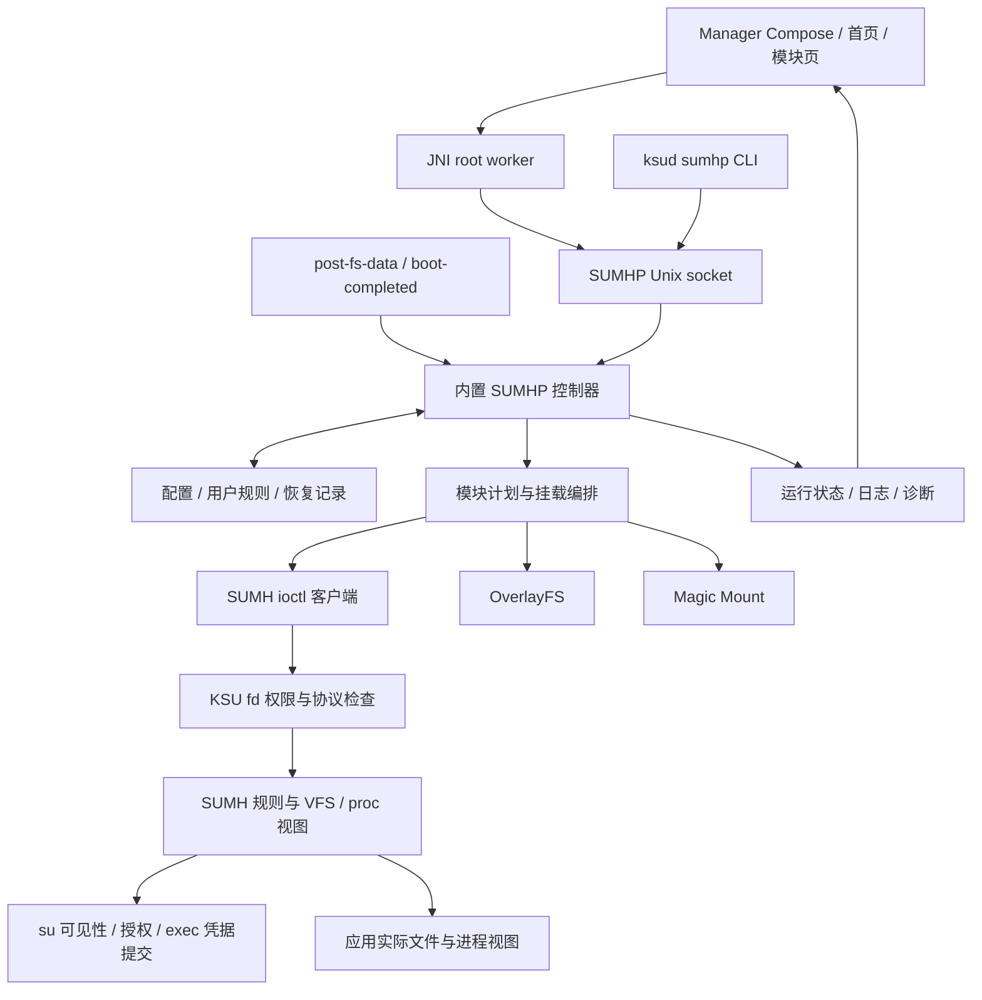

# SUMH 全面检查与改进实施计划

日期：2026-10-16（Asia/Shanghai）<br>
基线：`2a5ce441e9c923b8b0e89779f5c9ec95e6a97e46` 加本次检查开始时已有的工作区改动。<br>
交付性质：源码检查、改进建议和实施计划；已开始分批实施，任务的完整范围保持不变。<br>
增补状态：已合并功能强化与使用方式扩展，保留原 41 项任务，新增 F01–F13，共 54 项；现有用法另见[场景指南](../zh/guide/sumh-usage-scenarios.md)。

2026-10-21 按用户要求先完成基本闭合，停止本轮新功能扩展，转入实际测试。第四十六批配置方案页的复制对话框故障已修正，62 项本机测试全部通过；交付范围、产物限制和逐步测试见[测试交接](SUMH-basic-test-handoff-2026-10-21.md)。全部 54 项任务及真实设备门禁继续保留。

第四十六批推进 F07 的 Manager 未启用方案库：独立页面提供捕获、导入预检与保存、复制/改名/删除、资源差异及固定版本导出；私有文件传输保持既有容量，写操作前保存恢复检查点，未知结果只查询当前目标、不自动重放。实现与实际测试见[第四十六批记录](SUMH-implementation-validation-batch46-2026-10-19.md)，用法见[方案指南](../zh/guide/sumh-profiles.md)。激活、运行恢复和服务端方案操作日志仍待实现，F07 保持部分实施，全部 54 项及 F06/F11/F12 门禁不变。

第四十五批继续 S04：新增可移植原生证据校验、最终 ELF 只读加载段的嵌入字节证明，以及 APK → ksud → 选定 ksuinit/KMI 的严格发布关联。证据 ZIP 包含两个原生 bundle、符号和压缩 proof，发布目录完成暂存复验后才生成。实现、交叉审查和实际测试见[第四十五批记录](SUMH-implementation-validation-batch45-2026-10-19.md)，命令与限制见[来源指南](../zh/guide/sumh-native-provenance.md)。这是未签名的字节/证据一致性检查，完整 Manager/DDK 来源、真实 KMI 和设备验收仍待完成；全部 54 项及 F06/F11/F12 门禁保留。

第四十四批推进 S04：已解析的 Actions 固定 commit，四个 DDK 镜像按 KMI/release 离线选择 digest；原生 FetchContent 来源锁定，ksud/ksuinit 构建新增实际工具链、源码/依赖/资产指纹、产物清单、有限原生 SBOM 和许可证证据。该批历史实现与实际验证见[第四十四批记录](SUMH-implementation-validation-batch44-2026-10-19.md)。本地源码覆盖和未解析评论 Action 明确记录，原有证据保持封存。

第四十三批继续 C04/F05/F09：Manager 临时 Maps 删除接入正向能力协商、prepared/dispatching 私有检查点、单次执行、类型化回执和手动历史查询。新版 Manager 在旧控制器上保留查看，缺少追踪能力时提示更新；旧 CLI/旧 Manager 协议保持兼容。历史与当前集合分开，进程恢复不重放；本地 STM1 与隐藏 SOP1 独立。实现、静态复核、实际测试及设备限制见[第四十三批记录](SUMH-implementation-validation-batch43-2026-10-19.md)，步骤见[场景 33](../zh/guide/sumh-usage-scenarios.md#33-在-manager-追踪临时-maps-删除并查询历史当前源码已实现)。完整队列、其他资源、每调用者 owner 和真实设备验收仍待完成，全部 54 项及 F06/F11/F12 门禁保持。

第四十二批推进 C04/F05/F09：临时 Maps 精确删除新增可选的 CLI 预登记、本地至多一次执行和按 ID 类型化回执查询；普通直连 CLI 与 Manager 仍保留原行为。共享回执库升级 schema 2，旧 schema 1 先备份并读回确认；删除结果、回执留存和摘要结束分别报告。实现和实际验证见[第四十二批记录](SUMH-implementation-validation-batch42-2026-10-19.md)，使用见[Maps 指南](../zh/guide/sumh-maps-rules.md#临时删除的可追踪-cli-流程)。Manager 持久追踪、完整队列、真实存储/设备验证仍待完成；全部 54 项及 F06/F11/F12 的前置门禁保持。

第四十一批补齐 S03 的 Manager 当前日志清空合同：与写入器一致检查已打开文件的类型、单链接和大小，非阻塞打开并拒绝忙锁，保留系统错误，合法文件权限收紧为 0600 后才截断。现有失败提示与手动刷新入口继续使用。实际验证见[第四十一批记录](SUMH-implementation-validation-batch41-2026-10-19.md)，清空范围与重试步骤见[日志指南](../zh/guide/sumh-log-storage.md)。这不构成全链超时或文件系统事务；Linux/Android 并发、备份期限、完整 S03 及全部 54 项目标继续进行。

第四十批推进 C06：目录准备增加父 inode 屏障，PREPARED 阶段治理原生缓存；映射 atomic_open 复用 SUMH 投影并保留 VFS 打开合同。捕获的源身份由独立引用保护，发布和重验证拒绝过期投影。静态合同见[目录缓存设计](SUMH-dirhijack-cache-design-2026-10-19.md)，实际测试与失败修正见[第四十批记录](SUMH-implementation-validation-batch40-2026-10-19.md)。FUSE READDIRPLUS、纯虚拟后代、原生快速读取窗口、完整 owner 事务及真实 KMI/设备仍待验收，C06 和 F06/F11/F12 门禁保持，全部 54 项继续进行。

第三十九批继续推进 S03/M04/F08：Manager 新增四场景诊断包创建、列表、全文预览、系统文件保存和条件删除，配套独立原生通道。创建/删除前保存私有检查点，中断后查询已知 ID；导出前重新核对 revision 与完整字节。见[第三十九批记录](SUMH-implementation-validation-batch39-2026-10-19.md)和[Manager 使用方法](../zh/guide/sumh-diagnostic-packages.md#manager-操作)。完整诊断/恢复闭环、全量 bugreport 隐私、备份期限、Linux/Android 运行及设备验收仍待完成；54 项任务和 F06/F11/F12 门禁保持。

第三十八批推进 S03/M04 私有诊断包：四场景独立采样接入默认脱敏投影、明确身份保留选项、不可覆盖 ID、本地留存、完整字节预览、条件导出与定向删除。查询已有包不重新采样，不启动 daemon 恢复；保存结果与诊断证据状态分别解释。见[第三十八批记录](SUMH-implementation-validation-batch38-2026-10-19.md)和[诊断包指南](../zh/guide/sumh-diagnostic-packages.md)。通用 bugreport、原始 doctor、Manager 分享、完整 M04 状态覆盖、备份期限与设备/Linux 验收仍未闭合；S03/M04 保持部分实施，54 项目标继续进行。

第三十七批推进 S03 日志存储与重复消息：当前/上一启动日志各 1 MiB、512 KiB 完整记录尾部裁剪、共用固定暂存文件、每进程 32 项/30 秒 Warning/Error 汇总，以及后台标准流隔离已实现。补齐关闭标准流时启动确认 socket 的提前提升，保留前台 stderr 和命令结果捕获。具体执行证据见[第三十七批记录](SUMH-implementation-validation-batch37-2026-10-19.md)，行为、失败与清空边界见[日志指南](../zh/guide/sumh-log-storage.md)。S03 仍为部分实施：脱敏导出、备份期限、Linux 并发/断电、Android 长期存储与能耗验收尚未闭合。

第三十六批推进 U04 日志阅读：按行懒加载、可取消的后台解析/筛选、尾部重叠行标识、保留同来源读取快照及显式跟随/暂停已接入 Manager。读取失败与空日志分开；文本等级和控制台配色可独立检查。2026-10-19 最终 60 项主机测试通过，三张新截图已复核，大字体下日志来源完整显示。具体执行结果见[第三十六批记录](SUMH-implementation-validation-batch36-2026-10-18.md)，使用步骤见场景 28。U04 保持部分实施，真实设备 TalkBack、性能、横屏和长规则列表验收仍保留；全部 54 项继续推进。

第三十五批推进 F08/M04：新增精确本地 `doctor --input` 四场景只读诊断，将隐藏稳定定义、当前模块规划、受管 Maps 和启动保护证据与近期操作关联。保存、观察、历史和推断分别标注，未知结果先查询；本批不执行修复。独立采样、严格输入、容量和无副作用检查的实际结果见[第三十五批记录](SUMH-implementation-validation-batch35-2026-10-18.md)，步骤见[诊断指南](../zh/guide/sumh-diagnostics.md)。Manager 向导、恢复点关联和设备验收仍待完成，F08/M04 保持部分实施，C06/F06/F11/F12 门禁保留。

实施状态：首批 R01/R02/T01/F10、第二批 R03/R04 及 K02 虚拟目录部分已落地代码；第三批推进 R05/K07/U01 及 R04 兼容修正；第四批补运行状态、条件开关更新、C03 查询和模块/Maps 草稿；第五批增加 Kernel Build 条件设置及 U02 字段刷新保护；第六批新增七类结构化规则分页与 Manager 保存／运行状态展示。完整设备/发布验收尚未闭合。详见[54 项实施账本](SUMH-implementation-progress-2026-10-16.md)、[首批验证](validation/SUMH-batch-01-validation-2026-10-16.md)、[第二批验证](validation/SUMH-batch-02-validation-2026-10-16.md)、[第三批验证](validation/SUMH-batch-03-validation-2026-10-16.md)、[第四批验证](validation/SUMH-batch-04-validation-2026-10-16.md)、[第五批验证](SUMH-implementation-validation-batch05-2026-10-16.md)和[第六批验证](SUMH-implementation-validation-batch06-2026-10-16.md)。下文审查事实保留检查时基线，不能据原行号推定改动后仍有同一问题；后续测试证据单独记录。

## 1. 结论与优先顺序

第三十三批已实现 C06 的注入目录归属：所有映射与 MERGE 生产入口分别持有路径键和精确 inode 标记，替换、DEL、CLEAR 同步撤销；延迟回收仅释放资源。直接 ADD 路径准备错误返回，派生注入键单独删除返回 EBUSY。49 组主机场景、1,000 次循环、25 个定向行为变异、旧实现反例、LIST 声明回归及六个 ARM 模型对象已验证，独立源码/测试复核完成，详见[第三十三批记录](SUMH-implementation-validation-batch33-2026-10-17.md)。完整模块事务、其余派生状态、部分发布与真实内核/设备验收仍待完成；C06 保持部分实施，全部 54 项目标继续进行。

第三十四批已实现全部现有生产入口的精确目录挂接归属、共享虚拟祖先撤销、联合预检及退出生命周期，十文件通过独立静态审查，8 个专用视图、28 个行为变异、8 个旧实现反例、相邻回归及 14 个适用架构模型对象通过，独立测试审阅接受，本批主机与静态验收完成。[静态设计](SUMH-dirhijack-ownership-design-2026-10-17.md)与[实际执行记录](SUMH-implementation-validation-batch34-2026-10-18.md)分别保存。首次发布、atomic_open、FUSE READDIRPLUS 和纯虚拟后代缓存的一致性继续待办，C06 及 F06/F11/F12 的完整门禁保持不变。

第三十二批继续 C06 的目录缓存生命周期前置项：FOP inode 缓存独立持有 superblock 活跃引用，拒绝从零复活，安装失败和正常退休均先释放 inode 再释放 superblock；现有客户端保留及共享模板边界不变。详见[第三十二批记录](SUMH-implementation-validation-batch32-2026-10-17.md)。缓存可能延迟文件系统最终关闭；该批尚未覆盖注入索引/标记归属，owner 事务和设备验收仍待完成。

第三十一批继续 C06：符号链接在原生跟随查询后增加一次 nofollow 后置检查，按完整 mount+dentry 拒绝仍可观察到的替换，查询错误直接传播且不自动重试。实现、反例及证据边界见[第三十一批记录](SUMH-implementation-validation-batch31-2026-10-17.md)。ABA、动态链接和检查后的变化仍未解决，原子配对、owner 事务及设备验收继续保留，C06 和 54 项整体目标未完成。

第三十批推进 F05 Manager 临时 Maps 工作台：独立能力查询、手动分页、精确身份确认及单次条件删除已接入；所有删除结果均要求显式刷新，旋转和关闭重开保留当前操作，进程恢复只提示重新查询。源码、本地验证与设备边界见[第三十批记录](SUMH-implementation-validation-batch30-2026-10-17.md)。持久删除历史、每调用者 owner 和完整设备验收仍待完成，F05 与全部 54 项目标继续进行。

第二十九批（2026-10-17）推进 F05/K05：临时 Maps 独立分页查询和按精确键删除已接入本地 CLI；内核用独立能力位与 instance/generation 条件校验，保留受管集合、其他临时项及旧流快照。拒绝不改变集合或控制序列，成功发布只推进一次；无全局 clear 回退。详见[第二十九批验证](SUMH-implementation-validation-batch29-2026-10-17.md)及[定向删除指南](../zh/guide/sumh-maps-rules.md#临时数字规则的定向删除)。该批结束时 Manager 临时操作尚未实现，第三十批继续接入；持久历史、内核/设备并发和观察者验收仍待完成，F05/K05 与整体 54 项继续进行。

第二十八批（2026-10-17）继续推进 C06：普通源只做一次不跟随末尾链接的捕获；MERGE 物化先有界收集至 EOF，再在目录迭代锁外根据持有的父目录解析和安装非链接子项。递归共享名称、记录、目录、迭代与临时内存预算，错误明确传播。详见[第二十八批记录](SUMH-implementation-validation-batch28-2026-10-17.md)和[源对象边界](../zh/guide/sumh-module-rules.md#源对象身份与更新边界)。符号链接仍保留原生双查询语义，源内容可变、部分发布、owner 事务及设备验收仍未闭合；C06 保持部分实施。

第二十七批（2026-10-17）推进 C06 源对象生命周期前置项：ADD 安装复用已捕获的源身份；MERGE 保存完整挂载/目录引用，读取及根目录物化直接使用该引用。修复物化字符串分配失败后仍发布成功、嵌套错误未传播和重复嵌套误查替换路径。见[第二十七批验证](SUMH-implementation-validation-batch27-2026-10-17.md)及[源对象边界](../zh/guide/sumh-module-rules.md#源对象身份与更新边界)。初始 follow/nofollow、递归子项和内容仍非原子快照；owner/事务/设备验收未完成，C06 保持部分实施，F06/F11/F12 不因此开放。

第二十六批（2026-10-17）推进 F07：四类资源统一版本化方案、采集/命名/复制/删除、导入导出、按资源配置差异与独立耐久方案库已落地。所有方案保持未启用，读写走精确本地入口；不将双读采样宣称为跨文件原子快照。详见[方案指南](../zh/guide/sumh-profiles.md)和[第二十六批验证](SUMH-implementation-validation-batch26-2026-10-17.md)。激活、运行恢复、操作日志、Manager 和真实设备验收待完成，F07 保持部分实施。

第二十五批（2026-10-17）推进 K05：Maps 改为不可变有序索引和整条读取流固定快照，短 spinlock 仅用于发布及引用获取，每 VMA 不再持全局 mutex 扫链表；保留原优先级并将当前、准备及旧读者持有代计入共享预算。临时 1024 键与受管 256 条独立限额，旧流继续使用已固定集合。[第二十五批验证](SUMH-implementation-validation-batch25-2026-10-17.md)与 [Maps 指南](../zh/guide/sumh-maps-rules.md#规则快照与读取中的更新)记录实现、测试和行为变化。真实内核/设备并发、P99/吞吐及上线门禁仍待完成，K05 保持部分实施。

第二十四批（2026-10-17）推进 C06 短期计划与 journal：旧模块重建在修改前保存完整编译计划与独立 intent，首次失败后停止、不再二次全局清理；未解决的同启动记录阻止再次重建，热选择只在确认未修改时恢复。新增精确只读 `module rebuild-status`。源码、主机故障测试和 ARM64 构建见[第二十四批验证](SUMH-implementation-validation-batch24-2026-10-17.md)，行为边界见[重建指南](../zh/guide/sumh-module-rebuild.md)。C06 保持部分实施：首次全局 reset、外部 owner、源对象、并发和原子发布尚未解决，F06/F11/F12 不因此开放。

第二十三批（2026-10-17）推进 F13/T03 的独立观察者工具链：专用测试 APK 的普通进程与 isolated service、同源码 root helper 和离线期望比较器分别保留实际身份与原始观测；路径访问与委托 FD 区分，配置关联不冒充已应用证明。实现及本地验证见[第二十三批验证](SUMH-implementation-validation-batch23-2026-10-17.md)，使用步骤见[观察者指南](../zh/guide/sumh-observer-kit.md)。独立测试规则 owner/布置/回收、完整观察者矩阵及真实设备运行仍未闭合，F13/T03 保持部分实施。

第二十二批（2026-10-17）推进 K09 目录查找兼容：按实际头文件核对类型、以 6.16 为接口分支边界、精确解析函数及身份映射对象；适配保留权限、锁和引用合同，缺依赖继续不可用。实现和验证进度见[第二十二批验证](SUMH-implementation-validation-batch22-2026-10-17.md)，[兼容指南](../zh/guide/sumh-kmi-compatibility.md)明确四个声明来源与待完成的真实 KMI 验收。其他动态符号和 K09 完整范围仍待推进。

第二十一批推进 K02/K08 通用 MERGE 完整收集：每次调用的目标文本副本、打开目录引用和名称集合供注入与去重共用，移除四目标 dcache 限制，收集错误与容量不足在输出前返回，保留既有顺序和 inode 来源。实现、验证及未完成的锁/KMI/设备范围见[第二十一批验证](SUMH-implementation-validation-batch21-2026-10-16.md)，K02/K08 保持部分实施。

第二十批已完成 K08 活动目录的按需 PATH_MAX 堆缓冲、准备错误传播、原始及专用目录游标保留和独立清理。旧 PAGE_SIZE ioctl 输入、Maps 字段与传输预算保持兼容；历史测试及当时剩余问题见[第二十批验证](SUMH-implementation-validation-batch20-2026-10-16.md)。

第十九批已完成 K01 第一阶段代码、主机验证与文档：快照对象/缓冲、流缓冲与临时工作区共用 16 MiB 请求字节预算，完整计入扩容峰值；终止性读取错误释放对应存储，hooks 显示分类统计。17 组宿主执行、4 组 ARM ABI 编译和 7 项 CI 自检通过。proxy 对象及其可靠拒绝入口仍待完善，不宣称全部物理内存有界或真实内核/设备验收通过。见[第十九批验证](SUMH-implementation-validation-batch19-2026-10-16.md)与[使用说明](../zh/guide/sumh-proc-memory.md)，K01 保持部分实施。

第十八批已接入 F01 能力与作用范围中心：精确本地 `api capabilities`、专用有界只读采样与独立手动 Manager 页面分列保存设置、内核控制、构建原值/当前值及后端能力；失败保留带 boot ID/时间/来源的历史，实际后端/owner 和应用实测仍未知。原生 44 项快照/144 项传输与 ARM64 构建通过；Manager 全包 56 类、563 项中 561 通过、2 项因 Windows 符号链接权限跳过。代码、主机验证及文档已闭合，完整设备验收仍未闭合，详见[第十八批验证](SUMH-implementation-validation-batch18-2026-10-16.md)。54 项范围保持不变。

第十七批推进 F02 Manager 生产 Planner 预览：独立有界只读通道、保存/完整草稿比较、路径解释、严格输入绑定与过期保护已接入，完整结果保留在 Activity 工作流内并懒加载展示。当前只证明采样期间的 SUMH 编译贡献，不提供运行赢家、外部 owner、观察者实测或应用授权。源码、主机验证与待设备项目见[第十七批验证](SUMH-implementation-validation-batch17-2026-10-16.md)及[使用指南](../zh/guide/sumh-module-rules.md#manager-计划预览与路径解释)。54 项范围与 F02 未闭合验收保留。

第十六批推进 F04/U03 完整用户隐藏定义交换：增加完整/所选 JSON 导出、只读定义分页、本地未启用草稿、冲突和启用策略预检，以及带 revision 的逐项 import-id。每组最多 16 项、未知结果停止，复用预登记 ID 与类型化回执；保留原稿，不自动续传。原始字节、稳定 ID、容量与私有快照分别校验，真实设备验收及统一配置方案仍待完成。实施和实际测试见[第十六批验证](SUMH-implementation-validation-batch16-2026-10-16.md)。

第十三批推进 F04 控制器基础：用户隐藏定义加入稳定 ID、名称/备注/分组和 enabled，支持带 revision 的逐条/按组启停及定向重试；精确 hide status 只读分页，不启动 daemon。旧数组首次显式修改前备份，恢复只注册启用项，逐项失败与未知结果分别报告。Manager 先接入安全重试，本批结束时完整定义/分组界面和设备验收仍待实现；F04 保持部分实施。详见[第十三批验证](SUMH-implementation-validation-batch13-2026-10-16.md)和[定义使用指南](../zh/guide/sumh-user-hide-definitions.md)。

第十四批接入 F04 Manager 稳定定义工作流：停用项可见、名称/备注/分组编辑、逐条/多选/整组启停及注册/绑定状态分开显示；复用原列表和私有草稿。有界原生通道、完整分页核对、版本绑定确认及未知结果停止重放已实现。当批尚未覆盖预登记操作 ID、进程死亡结果恢复、格式交换及真实设备验收，F04 保持部分实施。详见[第十四批验证](SUMH-implementation-validation-batch14-2026-10-16.md)和[Manager 使用方法](../zh/guide/sumh-user-hide-definitions.md#manager-定义工作流)。

第十五批将稳定用户隐藏接入预登记操作协议：Manager 在执行前确认私有操作 ID 检查点，断连或进程重建后仅按同一 ID 查询，不自动重放或恢复批量队列。控制器新增独立有界的类型化资源回执留存与 `operation result`；历史摘要、原始回包、留存回执及当前规则分别解释。C04/U02/F04/F08/F09 继续为部分实施，其他资源、完整队列、格式交换及真实设备验收未闭合。详见[第十五批验证](SUMH-implementation-validation-batch15-2026-10-16.md)和[操作结果恢复](../zh/guide/sumh-runtime-state.md#按-id-恢复资源结果)。

第十二批推进 C04/F09：新增文件/stdin JSON 的 `operation prepare/execute`，先耐久登记 ID 与参数摘要，再由已有 daemon 消费同启动预约；重复和已淘汰 ID 不重新调用命令。新增结构化提交结果与逐流输出容量，查询升级 schema 2、账本升级 schema 3，保留旧 CLI/api state。这里只闭合预先获知 ID 和至多一次调用；完整资源结果、任务队列、Manager 历史、修改期限及设备验证继续保留，见[第十二批验证](SUMH-implementation-validation-batch12-2026-10-16.md)。

第十一批推进 C04/F08/F09 的操作追踪基础：原账本扩为最多 16 条/32 KiB 的近期历史，旧格式只读兼容并在首次修改前备份；独立 `operation list/show/wait` 绕过 daemon 恢复，区分已观察、未保留、等待超时和不可读取。命令结果不冒充运行验证，最终落盘失败也不自动重放。该批当时未实现的提交前身份由第十二批继续推进；完整 typed result、Manager 历史页面、队列与修改期限继续保留，见[第十一批验证](SUMH-implementation-validation-batch11-2026-10-16.md)。

第十批推进 F03：单模块生产 Planner 预检、与实际执行共用的 normalize dry-run、额外分区发现→选择→条件保存已接入 CLI/Manager；部分执行、持久性未确认和未知结果明确呈现。设备、后台生命周期和持久逐项恢复验收继续保留，见[第十批验证](SUMH-implementation-validation-batch10-2026-10-16.md)。

第九批推进 F02/F03/R06：共用生产 Planner 的只读 `module plan/explain [--input ...]`、五类模板草稿审查，以及模块发现/编译读取错误传播已落地。预览限定当前可挂载模块，配置/源元数据变化使比较失效；不提供应用 token、跨后端赢家或观察者实测。F02/F03/R06 仍为部分实施，该批当时未实现的预检/normalize/额外分区由第十批继续推进，真实设备验收仍保留，见[第九批验证](SUMH-implementation-validation-batch09-2026-10-16.md)。

第七批接入 Manager 有界集合读取、受管 Maps 当前身份核对及原生构建加固，记录见[第七批验证](SUMH-implementation-validation-batch07-2026-10-16.md)。第八批继续实现 F05：精确 `sumh maps preview` 绕过 daemon 恢复，展示本次解析与实际提交历史；Manager 增加手动预览、定义导入差异审查和选中导出。同启动 pending 提交阻止自动恢复，显式新提交保留取代关联。实现证据和未验收范围见[第八批验证](SUMH-implementation-validation-batch08-2026-10-16.md)。原 54 项范围不变；F05 为部分实施，其他未实现工作流命令仍为草案。

SUMH 已经形成“内核视图引擎 → 内置 SUMHP 控制器 → Manager/JNI → 启动、恢复和三种挂载后端”的完整链路。投入顺序为：**稳定性前置，现有能力完善并行，底层扩展分阶段。** 先保证恢复、错误处理和状态可信；同时补齐现有能力的使用指南、辅助编辑与场景设计；在控制契约和所有权闭环后交付预览、重应用和配置复用，再开放受管用户映射及元数据实验能力。性能优化继续以测量为依据，不整体重写。

源码检查发现的首批重点如下。这里的 P1 是工程处理优先级，不是漏洞严重等级。

| 顺序 | 重点 | 为什么先做 | 对应任务 |
| --- | --- | --- | --- |
| 1 | 统一安全模式与自动恢复条件 | daemon 启动的 hide 恢复与 boot-completed 路径的安全模式检查不一致 | R01 |
| 2 | 让启动保护和恢复结果可信 | 启动计数、禁用标记及 reset 存在忽略文件错误的路径 | R02、R03 |
| 3 | 完整校验落盘配置，隔离应用失败 | 文件加载比 patch 校验宽松；部分功能失败会关闭其他功能 | R04、R05 |
| 4 | 修正目录低内存错误语义 | 虚拟目录分配失败可能被当成正常缺项或不存在 | K02 |
| 5 | 控制内核快照总内存 | 每份快照有上限，但没有相同覆盖范围的累计预算 | K01 |
| 6 | 接通现有测试与发布检查 | SUMH Manager 测试未被当前构建命令的过滤器选中 | T01 |
| 7 | 恢复原生程序安全加固 | ksud 构建显式关闭 stack protector 和 RELRO | S01 |
| 8 | 限制大草稿进入 SavedState | 单路径限长不能限制所有草稿累计占用 | U01 |
| 9 | 建立持久的生效记录与操作结果 | 当前页面状态不足以跨进程重建“保存了但未生效” | C02、C03 |
| 10 | 明确超时和完整性边界 | Manager/CLI 期限不同；文本列表及大响应不能保证完整表达 | C01、C04、C05 |
| 11 | 单独验证 SUMH 的 su 授权执行链 | SUMH 是当前唯一 su 提供者，普通目录替身测试没有覆盖其凭据状态机 | S05 |

没有依据本次检查确认需要立即停发的 P0 安全漏洞。普通应用触发的资源压力、真实内核并发及设备权限边界仍需受控验证；不能把“存在优化空间”直接写成“可利用漏洞”。

## 2. 范围、方法与证据边界

### 2.1 检查范围

本次对 Git 跟踪的文本做 SUMH/SUMHP 名称及路径检索，再沿调用、构建和启动链路补充关联文件。初始索引命中 **305 个文本文件、约 71,362 行**，不含第三方源码树及锁文件。这是发现范围，不是逐行证明数量。

| 层面 | 本次读取、核对的主要范围 | 检查内容 |
| --- | --- | --- |
| 内核本体 | `kernel/sumh/`：52 文件、16,551 行 | bootstrap、规则、RCU、vnode、目录、proc、Maps、kstat、xattr、statfs、Unicode、兼容与失活代码 |
| UAPI 与内核集成 | `uapi/sumh.h`、`uapi/feature.h`；`kernel/core/init.c`、`runtime/boot_event.c`、`supercall/dispatch.c`、sucompat、kernel_umount、feature/policy | 权限、协议、启动、能力、应用策略、卸载与生命周期 |
| 控制器 | `userspace/ksud/sumhp/`：33 文件、9,175 行 | daemon、CLI、配置、日志、迁移、持久化、规则恢复及 ioctl 客户端 |
| 挂载与启动 | SUMH、OverlayFS、Magic Mount、storage/mount_fs；`init_event.cpp`、MetaModule、boot patch、ksuinit 构建与说明 | 后端所有权、回退、挂载结果、启动保护、外部控制器及恢复 |
| 管理器 | `ui/sumh/`：29 文件、4,890 行；`sumhp_jni.cpp`、首页/模块页集成、Natives、资源 | 状态、输入、生命周期、批量操作、诊断、性能、国际化、无障碍 |
| 验证 | SUMH 主机 runner、内核脚本、20 个 SUMH JVM/Compose 测试文件及关联测试 | 已有覆盖、替身限制、故障注入、验证链路缺口 |
| 交付与维护 | `.github/workflows/`、actions、CMake、依赖与签名配置、README/SECURITY、中文专题文档 | CI 触发、测试选择、发布、可复现性、供应链、文档归属 |

第三方库检查侧重依赖选择、版本来源、构建与许可证说明，**未逐行审计其全部实现**。未对 Git 全历史、线上 Actions 历史、仓库分支保护、发布密钥、所有 ROM 或厂商内核作验证。相关补齐工作已列入计划，不把它们默认为安全或通过。

开始时已有改动为 `.github/workflows/sumh-tests.yml`、`docs/zh/guide/magic-mount-validation.md`、`userspace/ksud/src/init_event.cpp`，以及两个新增的 boot mount notify 测试文件。它们包含挂载完成通知的补充；本文按工作区现状检查，没有把这项已有工作重新列成缺失功能。

### 2.2 证据等级与本轮验证

- **E：源码事实。** 可以从当前分支、数据结构、调用和构建配置确认；不自动代表设备上的影响已复现。
- **V：待验证的影响。** 有具体代码依据，但并发、内存压力、厂商行为或性能收益需运行验证。
- **D：演进建议。** 用于降低维护成本、改善体验或扩展能力，不当作当前缺陷。

本轮完成源码与配置核对、调用可达性检查、资源翻译覆盖统计及日志色彩对比度计算。内核分工记录了 core、directory_names、directory_stream、rules 四组主机脚本通过；这些只涉及提取函数及内核 API 替身，没有作为安全隔离验证、完整内核或发布通过证明。完整 Gradle、全量宿主回归、四个 KMI 构建、Android 设备、真实并发和性能测量仍未完成。

功能增补另沿 UAPI → ioctl/client → Planner/CLI → JNI/Manager → 使用指南核对现有入口与可达行为，提出 F01–F13。增补交付是计划与指南，不是这些功能的实现，也没有追加设备、构建或性能通过结论。文档校验与产品测试分开记录。

安全部分使用 `security-audit` 的边界与证据准则。本次没有建立其要求的完整 OS 强隔离执行环境，也未完成正式漏洞猎取、逐候选独立动态验证的完整流程，因此安全专项记录为 **incomplete / 源码预审**，没有确认漏洞清单。其记录校验器还因 Windows 上缺少所需 no-follow/nonblocking 文件保护而拒绝运行，未记为通过。该限制不影响本文作为改进实施计划交付；S02/T03 包含后续完成安全验证的条件。

### 2.3 应保留的已有能力

已有锁序与生命周期保护、RCU 退役及延迟释放、旧 KMI fops bridge、受管 Maps 原子替换、配置文件锁、临时文件替换、私有目录及部分 no-follow 检查。传输已有容量、deadline 和“写请求可能送达后不重放”的保护；Manager 已区分保存/应用结果，具备批量进度、停止、失败重试、草稿恢复、不完整列表提示及受管规则删除边界。

目录名称去重已经采用红黑树，单次名称比较为 O(N log N)，不是未优化的全量 O(N²)。后文 K03/K04 针对其他扫描、重建和刷新环节。原生 namespace 身份和已撤除的 aggressive 模式边界也应保留，不重新引入仅修改文本而破坏跨接口一致性的路径。

功能复核还确认：用户隐藏页已有搜索、筛选、多选、批量操作、进度和失败重试；模块已有最长前缀、`none` 嵌套例外、目录 MERGE 和 whiteout 处理；Maps 已有路径持久化和受管集合原子替换。Kernel Build 原值查询及展示、自定义 `su` 路径设置也已存在。F 系列复用这些基础，不将现有功能重复计为新增。逐条暂停、计划解释及配置方案等能力的边界见第 8 节。

## 3. 架构与关键不变量



每项改造都必须保持以下不变量：

1. **身份与权限：** 内核入口的 Manager/root 检查不能被 UI 或 daemon 的“可信”假设替代。普通应用、已授权 root、Manager、模块脚本的权限分别建模；具有同等 root 权限的自影响不直接归类为越权。
2. **状态：** 支持能力、保存意图、已提交操作、运行状态、应用观测是不同事实。未知、失败和空集合不能互相替代。
3. **规则所有权：** 用户 hide、模块映射、受管 Maps、临时数字 Maps 分开管理。批量删除、恢复与回滚不能扩大到其他来源。
4. **失败：** 读取失败不等于清空；保存成功不等于生效；超时不等于取消；目录内存不足不等于不存在；回滚失败必须可见。
5. **恢复：** 先获得可恢复的配置和旧计划，再进行可能影响启动的变更。安全模式的自动行为由统一规则决定。
6. **兼容：** 新能力通过能力位及明确结构协商；旧 UAPI 槽位、字段语义和降级路径保留。当前 32 位 compat 调用被显式拒绝，不把仅 ARM64 支持误写成 ABI 漏洞。
7. **生命周期：** 已打开 FD、RCU/SRCU reader、异步 I/O、probe 与延迟释放对象都有明确拥有者和停止顺序。当前模块自持 pin 不等于支持热卸载。

## 4. 完整改进任务

优先级：**P1** 下一轮稳定性或发布保障重点；**P2** 随后交付的主要改进；**P3** 有基线或需求支持后再推进。负责人是建议角色，不代表已经指派。行号对应本次工作区，后续修改应以符号名重新定位。

### 4.1 恢复、持久化与功能正确性

| ID / 优先级 | 事实、影响与依据 | 具体改进 | 验收标准 |
| --- | --- | --- | --- |
| **R01 / P1 / E+V** | `daemon.cpp:358` 启动即恢复 hide；相邻 Maps 分支检查 safe mode；`mount/sumh.cpp:521` 的恢复仅检查 boot stage/kernel。`embedded.cpp:92` 又有安全模式保护。实际是否改变应用视图仍需设备验证。 | 提取统一 RestorePolicy，覆盖 safe mode、boot stage、外部挂载 owner、能力；只读查询拉起 daemon 时遵守同一恢复规则。明确自动恢复与用户主动恢复的区别。 | safe mode 下首次查询、daemon 重启、boot-completed 均不自动发恢复 ioctl；正常模式及外部 MetaModule 场景按约定恢复。 |
| **R02 / P1 / E+V** | `mount/backend.cpp:107` 读计数失败归零；`:114` 写计数不返回错误；`:703` 禁用标记不检查写入；`:879` reset 忽略删除错误。`core/command.cpp:1388` 无条件报告 reset 成功。 | 计数、禁用标记、确认启动、reset 使用有结果的存储接口，区分缺失/损坏/不可读；记录 boot ID、阶段、原因；保护记录无法提交时按明确的保守策略停止自动挂载并给出恢复信息。 | ENOSPC/EIO/EROFS/删除失败不报成功；每个提交点中断可恢复；连续未确认启动触发保护，成功启动正确清零。 |
| **R03 / P1 / E+V** | `userspace/ksud/src/utils.cpp:654` 已 fsync 临时文件并 rename，但缺少父目录 fsync；`sumhp/src/core/log.cpp:75` 已有目录同步先例。进程级原子替换不能直接推出掉电耐久性。 | 增加 durable replace 接口；区分未提交、已替换但耐久确认失败、完成；关键配置/规则/恢复记录采用同一语义。普通日志可选择不同耐久策略。 | 故障注入覆盖 write/close/file-fsync/rename/dir-fsync；掉电恢复模拟得到完整旧值或新值；已 rename 的失败不能被当作“文件未改变”。 |
| **R04 / P1 / E** | `core/config.cpp:181` patch 严格校验，`:346` 文件加载仅对部分字段执行相同校验；`:384` 其他字段使用宽松默认。`:458` 删除未知字段。 | 定义 ConfigDocument/schema version；迁移与运行校验分开；全部入口共用字段类型、枚举、范围与路径契约；未来字段保留或拒绝写入，避免旧客户端静默丢配置。 | 手工损坏、旧版本、未来字段、错误类型、NUL、相对路径、非法分区全部有 golden case；失败保留文件和旧运行状态。 |
| **R05 / P1 / E** | `mount/sumh.cpp:463` 顺序应用；`:505` 任一前置功能失败会调用 disable_kernel_features。`core/command.cpp:441` xattr 恢复失败也重置其他功能。Maps 解析失败已有独立保留策略。 | 能力预检；按功能记录旧值和执行结果；可回滚项恢复旧值，不可回滚项明确部分生效；不要默认用“全部关闭”代替回滚。 | 每个 ioctl 序号失败均验证无关功能保留；rollback_failed 可见；Maps 现有原子性不退化。 |
| **R06 / P2 / E+V** | `mount/mount_fs.cpp:71` 属性复制 best-effort；`:145` mirror_entry 遍历未像 copy_tree 一样区分 readdir EOF/错误。 | 统一 checked iterator；区分必要 mode/owner/SELinux label 与可选属性；必要属性失败阻止提交，返回具体路径、阶段、errno 并清理临时对象。 | 中途 readdir EIO、chmod/chown/label 失败不被报告为完整挂载成功；不支持可选 xattr 的文件系统仍按明确策略工作。 |

表中 `core/`、`mount/` 未写全前缀的 C++ 文件均位于 `userspace/ksud/sumhp/src/`。

### 4.2 内核正确性、内存与性能

| ID / 优先级 | 事实、影响与依据 | 具体改进 | 验收标准 |
| --- | --- | --- | --- |
| **K01 / P1 / E+V** | `features/sumh_fake_mountinfo.c:74,594` 两份缓冲各从 64 KiB 到 1 MiB，生命周期绑定快照；`hooks/sumh_proc_read_hooks.c:39,245` 的 stream 总预算没有同时覆盖这些快照。设备级影响待验证。 | 为 snapshot、stream、proxy 建统一计费；先总预算，再按实测决定 UID/namespace 配额；评估共享相同 generation 的只读快照及收缩到实际长度。 | 受控多 reader/FD 场景内存达到预算后稳定；拒绝和分配失败可观测；关闭 FD 后账目回到基线；不得以静默返回不一致视图处理超额。 |
| **K02 / P1 / E** | `policy/sumh_path_policy.c:680` 分配失败返回 NONE，`:776` 枚举分配失败 continue；`core/sumh_vnode.c:583` 不检查枚举结果。 | 返回类型区分无匹配、内存不足和部分输出；尽量在 RCU 外预分配/构建目录数据；已经发出部分项的场景制定可续读语义。同步修改当前允许跳项的测试期望。 | 每个分配点注入失败，不能成功报告缺失条目或正常 EOF；getdents 小缓冲续读无稳定规则下的遗漏和重复。 |
| **K03 / P2 / E+V** | `sumh_path_policy.c:722,752` 查询/枚举扫描规则表；`sumh_vnode.c:571` 每轮重建并从 2 编号。并发规则变更下 cookie 稳定性未证明。 | 建 parent→children 索引；选择每 open 固定 generation 或明确稳定 cookie，先写语义再实现；补纯虚拟目录专项。 | 固定规则下完整遍历；增删、seekdir/telldir、rewind、旧 FD 的行为符合规范；测量重建次数和延迟。 |
| **K04 / P2 / E+V** | `core/sumh_hide_rules.c:90` 每找下一规则都从链表头开始，全量选择可能为 O(N²)；`sumh_hide_events.c:204` 逐规则重建祖先 watcher。 | ID/path 索引、pending 队列、事件到受影响规则的反向索引；共享祖先 watcher；拓扑大变更保留全量刷新。 | 100/1000/10000 规则的收敛时间、watch 数与 CPU 增长得到测量；重挂载、rename 和重试不漏绑定。 |
| **K05 / P2 / E+V** | 初查 `hooks/sumh_proc_read_hooks.c` 每 VMA 用全局 mutex 扫 Maps 规则；托管上限 256，legacy 无共同预算。第二十五批已实现 `core/sumh_maps_store.c` 不可变索引。 | 采用短 spinlock 获取引用/发布与整流固定快照，替代原拟 RCU 回收，避免睡眠流跨 RCU 和异步释放复杂度；精确/通配与 legacy/managed 优先级不变。临时 1024 + 受管 256，所有存活代与准备/input 副本纳入共享 16 MiB。 | 宿主确定性交错、故障与算法对比只能作为本地证据；真实多 VMA、多 reader、更新并发、UAF、KMI/CFI 及 P99/吞吐仍需验收，之后决定是否上线。 |
| **K06 / P2 / E+V** | 热路径全局 atomic64 计数、快照全局锁；`control/sumh_ioctl.c:1423` GET/SET 共用 mutation mutex；GET_FEATURES 可触发 hide 初始化。 | 分离显式初始化、只读快照与写事务；评估 per-CPU 计数/诊断开关、缩小锁范围；先记录锁等待再修改，保持既有锁序。 | 规则修改、慢路径解析、用户页 fault 下状态延迟可量化；lockdep/KCSAN 无新增问题；无收益时保留简单实现。 |
| **K07 / P1 / E** | `control/sumh_ioctl.c:741` SET_MAPS_SPOOF 未按 proxy readiness 拒绝 enable；`:783` GET_FEATURES 却以 proxy 注册决定能力。相邻 statfs 已检查可用性。 | 在最终 ioctl 边界统一 supported/configured/active/degraded/last_error；不支持 enable 返回 EOPNOTSUPP；关闭与清理仍允许。能力查询不替代写入口校验。 | 缺符号、probe 注册失败、重复开关下，直接 ioctl、CLI、UI 结论一致；不支持不被显示为已生效。 |
| **K08 / P2 / E+V** | 常规规则接收 PAGE_SIZE 路径，`hooks/sumh_vfs_hooks.c:402` 活动目录路径缓冲只有 512；获取失败可能不建立对应 merge targets。 | 明确用户路径、内部路径、Maps 显示字段三种预算；动态或有界池分配，避免扩大内核栈；超限显式失败。 | 255/256/511/512/4095 UTF-8 字节、长符号链接、相对/openat 路径，接收与实际行为一致。 |
| **K09 / P2 / E+V** | 动态私有符号、手写 proc_mounts 前缀、SUMH_NOCFI、共享 flags 的 40–45 位和 IKCONFIG unknown 路径构成兼容风险。见 `features/sumh_fake_mountinfo.c:29`、`internal/sumh_base.h:14`、`uapi/sumh.h:25`、`core/sumh_config_guard.c:83`。 | 收拢 typed KMI adapters；记录原型、ABI 家族、失败影响；诊断暴露 unknown；内部位定义移离公共协议时保持旧 ABI，评估侧表需实测。 | 四个支持 KMI、KCFI、缺符号、厂商差异、4K/16K 页配置按实际支持范围构建/测试；未测组合明确标记。 |
| **K10 / P1验证、P2改造 / V** | vnode read_iter/write_iter 临时替换 `kiocb.ki_filp`（`core/sumh_vnode.c:297,312`）；现有 mock 不能证明异步完成、旧 FD 和真实 RCU/SRCU 时序。尚无据此确认的异步缺陷。 | 建对象所有权、回调上下文、stop/drain/free 顺序表；增加必要断言；对异步返回与完成上下文单独设计验证。不得无验证删除 bridge 或模块 pin。 | KASAN/KCSAN/lockdep/RCU debug 下验证异步 I/O、共享 FD、并发清理、低内存和重新配置；发布说明明确不支持的行为。 |

本节所有相对内核路径均位于 `kernel/sumh/`；K09 的 `uapi/sumh.h` 为仓库根目录路径。

第五批 K07/R05 进展：Kernel Build 新增独立条件设置能力，复用 instance/generation，完整两字段读回；冲突或结果未知不盲目回滚，旧内核取消无法证明归属的回滚。CAS 接口能力与 UTS 机制支持分别检查；宿主生产函数、ARM32/ARM64 ABI、客户端及显式 CLI 接线回归通过，最终 ARM64 ksud 编译链接通过。CLI 应用失败不再盲目写回旧保存字段。Manager 全部状态 DTO、真实内核/KMI 与设备证据仍缺，K07 不标为完成。详见[第五批记录](SUMH-implementation-validation-batch05-2026-10-16.md)。

### 4.3 协议、控制面与跨层一致性

| ID / 优先级 | 现状与依据 | 具体改进 | 验收标准 |
| --- | --- | --- | --- |
| **C01 / P2 / E+D** | `uapi/sumh.h:49` 旧列表为文本；`sumh_ioctl.c:565`、`sumh_client.cpp:113` 受固定缓冲限制；`command.cpp:587` 的空白切分不能无损表示合法路径。 | 新增能力位控制的结构化分页枚举：固定宽度字段、size/reserved、rule ID、owner、类型、长度、cursor、generation、complete；旧文本保留 raw 降级。 | 超 64 KiB、空格/CR/LF/Unicode、分页期间增删、旧新客户端/内核组合；不完整或歧义列表禁止驱动破坏性推断。 |
| **C02 / P1设计、P2实施 / E+D** | `SUMHWorkspace.kt:69` 待应用标志主要依赖页面 SavedState；`SUMHManager.kt:168` 保存/应用失败结果没有后端持久账本。 | 后端维护 desired revision、applied revision、boot ID、分功能状态、最后应用结果；状态从运行事实重建，不能仅用保存的 revision 推断内核仍保留规则。 | 保存后应用失败、进程死亡、CLI 外部修改、daemon 重启、内核重新初始化都能重新展示正确 drift 与下一步动作。 |
| **C03 / P2 / E+D** | Manager 完整刷新串行多次 JNI/daemon 调用；`command.cpp:396` snapshot 将部分错误降为 0/false/空串且返回成功，与 JNI 抛错语义不同。 | 统一版本化 Snapshot DTO，包含版本身份、分区结果、来源、采样时间/generation；无法原子采样的内核/文件边界显式标注一致性，不伪造全局原子快照；首页用轻量摘要。 | unavailable/unsupported/error/empty 可区分；CLI/JNI golden fixtures 一致；可选 storage/log 失败不抹掉已知内核状态；记录 root 调用数和冷/热延迟。 |
| **C04 / P1边界、P2任务化 / E+V** | `daemon.cpp:376,454` 串行执行；CLI 约 60 秒、JNI exchange 15 秒；`sumhp_jni.cpp:119,154` join/启动 waitpid 没有完整端到端期限。 | 总预算涵盖排队、启动、连接、执行等待；引入 operation ID、阶段、结果查询；写操作保持串行，只读健康快照独立响应；只在安全阶段取消，未知结果先查询。 | 卡住启动进程、慢挂载、断连、队列满、服务重启后 UI 可恢复；不会超时后盲目重复写；查询能判明最终提交结果。 |
| **C05 / P1容量闭环、P2分页 / E+V** | `command.cpp:1321` 一次输出全部 hide，添加只限单路径，`:1506` 使用无总量上限 stringbuf；接收端限制 1 MiB。合法逐条添加可形成一次读不回的集合，JSON 转义进一步扩大响应。 | 服务端在生成阶段计费；列表分页、错误输出限额、显式 partial/has_more；共用 CLI/JNI 的帧、编码预算和错误契约；已有大配置仍须可分页读取和清理，不能简单加小上限使它失去访问能力。 | 1 MiB 前后、长 UTF-8/引号/反斜杠路径、大量规则、半帧均有明确结果；成功添加的数据总能读回；内存受控，不能静默截断后标记完整。 |
| **C06 / P2 / E+D** | `backend.cpp` 仍先全局清理再逐条重放；preflight 不提供内核原子提交。第二十四批已留存计划/journal；第二十七、二十八批统一源引用、普通源单次捕获、相对持有父目录解析及有界物化；第三十一批增加链接后置检查，拒绝末次查询可观察的替换；第三十二批补 FOP inode/superblock 缓存生命周期；第三十三批为全部映射/MERGE 生产入口补注入路径键和精确 inode 的独立归属及同步撤销，执行验收见批次记录。第三十四批补目录挂接归属；第四十批补首次准备屏障、PREPARED 原生缓存治理、投影身份和 atomic_open。原子链接配对/ABA、可变内容、FUSE/纯虚拟缓存、其余派生状态和错误后的部分发布仍未闭合。 | 保留完整目标：限定模块 owner 的 prepare/commit 或 generation replace，配 expected_generation/幂等结果查询；所有派生对象和源生命周期纳入设计；跨后端切换不承诺全局原子。 | 第 N 条失败、源文件替换、内存不足、回包失败时旧集合保留或可精确恢复；不误删其他 owner；并发修改显式冲突。源引用宿主回归已补，真实内核及设备验证仍待完成。 |

第五批 C02/C03/C04 进展：新增已实现的 `api state` 和 schema 1 最后操作记录，逐功能摘要保存意图，并用当前采样、boot/instance 和历史验证限制 applied revision。受记录修改先保存 started，结果写入失败不重放；保留未知/损坏格式。模块映射、Maps 受管身份和 overlay xattr 缺少完整枚举时保持未知，隐藏只验证登记定义、绑定状态逐条采样。宿主故障测试与 ARM64 编译通过；完整历史/typed unknown 结果、operation show/wait、端到端期限、自动恢复全面接入与 Manager 状态消费尚待完成，不能把最后操作日志当成全流程事务。详见[运行状态指南](../zh/guide/sumh-runtime-state.md)。

第六批 C01/C02/C03 进展：新增独立能力的七类固定页枚举及 `api inventory`；已验证跨页 token、原始路径字节、owner/ID、完整性和最大编码输出。旧文本始终标为不完整，未支持类别不伪装为空。Manager 已消费 state/runtime schema，显示部分事实、错误、历史与过期采样。`api state` 尚未用枚举结果核对 Maps 的当前文件身份；模块仍需 Planner、源树和 owner，不能仅凭登记路径输出 applied revision。完整消费者、其他类别、C04 全操作结果、端到端期限及设备证据仍缺，C01–C04 保持部分实施；详情见第六批验证。固定页不代表完整扫描性能改善，当前序号遍历累计可为 O(N²)。

### 4.4 Manager 体验、生命周期与可访问性

| ID / 优先级 | 现状与依据 | 具体改进 | 验收标准 |
| --- | --- | --- | --- |
| **U01 / P1 / E+V** | `SUMHRuleDrafts.kt:10` listSaver 保存全部草稿；批量输入未设累计字节预算。结果摘要已有容量治理，不能证明草稿也受保护。尚未实机复现 Bundle 崩溃。 | 大草稿存应用私有持久存储，SavedState 只保留 ID/小摘要；定义总字节、行数和单行预算；超限提供分块文件导入，不静默丢数据。 | 多规则草稿累计、大文本粘贴、旋转、后台、进程重建；SavedState 大小受控，完整路径可恢复。 |
| **U02 / P2 / E** | `SUMHUiAdapter.kt:243` 部分异常压成 Boolean；`SUMHConfig.kt:212` 确认后关闭编辑态，`SUMHSettings.kt:285` 路径验证失败仍可能收起。 | typed result 替代 Boolean；字段内显示错误、失败保留焦点/输入；只有保存确认成功才关闭；区分已保存、未执行、部分执行、未知结果。 | 路径不合法、权限拒绝、超时、保存失败和部分应用的 UI 测试；用户能看到失败阶段及可执行下一步。 |
| **U03 / P2 / E+D** | 单 hide 路径允许 LF/CR，旧逐行工具不能无损往返。第十六批 [完整定义交换](../../manager/app/src/main/java/com/zying/zysu/ui/sumh/util/SUMHHideTransfer.kt)及私有草稿/完整分页已实现；旧逐行工具单独保留。 | 保留便捷逐行输入，增加 versioned JSON 导入/导出、冲突预览、来源与持久性说明；导入仍使用逐项结果与停止机制。 | LF/CR/TAB、末尾空格、中文、重复、无效项、旧版本数据精确往返；导出不把模块规则当用户规则重放。完整设备文件提供者和生命周期验收待闭合。 |
| **U04 / P2 / E+V** | 原 `SUMHConfig.kt` 的 VERBOSE 对比度约 2.64:1，主线程筛选并用大 Text 展示。第三十六批已拆分 `SUMHLogsTab.kt`、`SUMHLogReader.kt` 与 `SUMHLogView.kt`，补后台筛选、稳定行身份及阅读控制；[验证记录](SUMH-implementation-validation-batch36-2026-10-18.md)。 | 语义色板普通文本至少 4.5:1，保留文字等级；字号适配；日志按行解析/后台筛选/懒加载、稳定 key、暂停跟随；长规则编辑列表按需组合。 | 亮/暗主题、TalkBack、2 倍字号、窄屏横屏、最大日志和 256 条长路径；无单靠颜色的信息，输入延迟和卡顿有测量。 |
| **U05 / P2 / E+D** | 默认 SUMH/navigation 的 10 个资源文件共 285 个 key；简中完整，抽查 TW/HK、日/阿/俄/西/法各有 175 个 key 回落默认语言。这是翻译覆盖，不是缺资源崩溃。 | 先翻译核心状态、错误与恢复操作；建立保存/生效/待绑定/临时/持久术语表；CI 校验 key、占位符/plurals；覆盖 RTL/伪本地化。 | 选定支持语言核心流程完整；不得为追求数值覆盖复制英文冒充翻译；长文本、RTL 和格式参数验证通过。 |
| **U06 / P2/P3 / D** | 配置、请求、刷新和 Compose 状态分散；已有用户规则操作容器及 LazyColumn，应继续复用。 | Repository/ViewModel 与不可变 DTO、单向状态流、生命周期感知收集；首页展示分层健康摘要、最后刷新、实际后端/owner/回退原因；规则展示来源、持久性及绑定状态。 | 离开页面后操作可查询，返回页面状态正确；配置变更不丢已发送操作；常见“规则为何没生效”不必靠猜开关回答。 |

本节 Kotlin 文件位于 `manager/app/src/main/java/com/zying/zysu/ui/sumh/` 或其 `util/` 子目录；完整定位见附录 A。

第五批 U02 进展：Kernel Build 和挂载来源/路径设置按字段保留草稿、已保存基线与待确认提交；干净字段接受刷新，脏字段要求明确选择，较早保存的读回不覆盖新输入。路径校验失败或未知提交结果不会自动收起编辑器；Maps 同目标读回也保留后续输入。Manager 全包 27 类、160 项宿主测试通过。全入口 typed result、后端 revision/operation 对齐、Maps 添加/重命名后的稳定身份及真实设备生命周期仍未完成；本段不缩减 U02 的原验收标准。

第六批补充：Manager 状态页和设置页显示保存值、configured、active、支持状态与最近操作；后端状态未知时先查询，旧页面待确认标记仅作为旧控制器回退。可选查询失败保留配置和明确过期的旧采样，非零响应中的合法部分事实不丢弃。该进展属于 C03/U02/F01 的控制状态部分，尚不替代全入口结果合同、完整后台任务、观察者实测或 ViewModel 生命周期验收。

### 4.5 安全、隐私与供应链

| ID / 优先级 | 证据与边界 | 具体改进 | 验收标准 |
| --- | --- | --- | --- |
| **S01 / P1 / E+D** | `userspace/ksud/CMakeLists.txt:80,107,122` 显式禁用 stack protector/RELRO；`ksuinit/CMakeLists.txt:26` 也有 norelro。root 程序仍需要内存破坏缓解；这不是已确认可利用漏洞。 | 按产物与目标工具链评估 stack-protector-strong、RELRO/NOW、FORTIFY 等适用项；发布构建默认启用可用加固，保留可诊断符号映射/构建身份；测量体积与启动影响。 | 检查最终 ELF 和编译命令而非只看 CMake；动态/静态链接分别判断适用性；原生回归及目标设备启动通过。 |
| **S02 / P1验证、P2加固 / E+V** | `kernel/supercall/dispatch.c:1092` 已有 Manager/root 与 compat gate；runtime 私有目录、JNI peer credential 检查存在；daemon 接受连接的最终权限依赖 DAC/SELinux 等组合。 | 建入口×身份×资源权限表；核对 daemon 双向 peer 身份、授权撤销、共享 UID、多用户、isolatedProcess、模块脚本与 WebUI 的真实权限。缺额外 peer 检查作为纵深加固，不能直接写“任意应用可控制 daemon”。 | 在强隔离环境用合成主体验证拒绝/允许边界；完整链路与真实影响才能升格漏洞；缺少部署事实时列明待验证条件。 |
| **S03 / P2 / E+D** | 原日志仍可能含私人数据；第三十七批补日志预算、重复汇总和后台输出隔离，第三十八批 `diagnostic_package*` 补独立的受限诊断包，见[记录](SUMH-implementation-validation-batch38-2026-10-19.md)。 | 日志大小/数量预算、重复错误聚合和分级开关；用户主动生成默认脱敏诊断包，并明确选择保留身份。当前包可完整预览、条件导出/删除，最多 8 份；全量系统报告的隐私及备份权限/期限继续实施。 | 主机投影、存储故障和精确命令入口验证单列；不把包内别名称为保证匿名。旧 doctor 与 Manager bugreport 未改为脱敏；长期磁盘/能耗、Linux 并发/断电、Android 权限与文件提供者仍待验收；第三十九批 Manager 入口见独立记录；第四十一批补当前日志清空的单链接校验、非阻塞争锁、错误传播与原生回归，真实并发及设备门禁保留。 |
| **S04 / P2 / E+D** | 初始审查时 Actions/DDK/部分 FetchContent 使用可变 tag。第四十四批固定 52 处 Action、四个 DDK digest、原生依赖并生成局部来源证据；第四十五批增加可移植验证、最终 ELF 嵌入 proof 和 APK/ksud/选定 KMI 的统一发布字节清单，见[验证记录](SUMH-implementation-validation-batch45-2026-10-19.md)。两处评论 Action 仍为例外，Manager/DDK 源码构建记录明确缺失。既有签名/发布门禁保持。 | 继续固定完整执行依赖的 SHA/digest 并建立升级流程；完善 Manager/各 KMI 的真实源码/dirty、工具链和依赖来源，以及完整依赖图与许可证材料；审视 DDK privileged 的需求；隔离 PR、签名和发布权限。 | 从 APK 内 ksud 到各 LKM 的字节及真实构建来源可追溯；两次干净构建差异可解释；缓存/依赖升级经验证；保留已有签名/发布保护。未签名局部字节证据不替代完整来源、真实 KMI 和设备验收。 |
| **S05 / P1验证 / E+V** | `kernel/feature/sucompat.c:37` 明确 SUMH 是唯一 su 提供者；`kernel/feature/sucompat_vfs.c:31` 管理可见性/身份/重绑定，`kernel/feature/sucompat_exec.c:146` 起处理授权与多阶段凭据提交。当前目录流测试把 su 可见性替身固定为 false，未找到直接覆盖此状态机的入口。未确认越权漏洞。 | 将 su 链作为独立高风险测试对象：授权撤销、open/exec/commit 间变化、自定义路径更新、旧 inode/FD、execveat/AT_EMPTY_PATH、O_PATH、ptrace、root profile/seccomp、SELinux、缺失 ksud、初始化失败。 | 支持的成功路径与关键拒绝路径都可重复；多阶段失败不提交部分权限；重绑定后旧对象语义明确；四 KMI 编译外至少一个可恢复设备完成全链验证并纳入发布检查。 |

### 4.6 测试、性能验证与发布保障

| ID / 优先级 | 现状与依据 | 具体改进 | 验收标准 |
| --- | --- | --- | --- |
| **T01 / P1 / E** | `.github/workflows/build.yml:258` 只选 update、superkey、ShortcutMigration 单测；SUMH Compose/JVM 测试未被选中。`sumh-tests.yml` 缺 workflow_call/tag 入口，`release.yml:82` 只经 build，没有等待该独立回归；path filter 也未涵盖全部依赖。 | 将 SUMH native/daemon/mount 及 Manager 回归封装为可复用工作流，发布在同提交调用并等待；补触发路径或由单一依赖清单生成；汇总实际执行/跳过结果。build plan 的 unittest discover 不等于各脚本 main 中的 C 编译运行。 | 单改 UI/common JSON/内核集成触发对应任务；故意制造 SUMH native 或 UI 失败时 tag 发布停止；报告绑定 release commit。完整四 KMI 构建入口已存在，不重复建设。 |
| **T02 / P2 / E+D** | 多个 runner 通过字符串/签名切片生产函数并注入替身；便于边界测试，但不能证明正式 translation unit/真实锁行为。SUMH runner 没有统一 sanitizer 入口。 | 逐步提取可直接编译的配置、传输、计划、存储小 target；保留故障注入；增加 ASan/UBSan、协议/JSON/规则 fuzz 和 Linux 真实 socket 集成。 | 重排非接口代码不破坏提取器；生产源持续编译；测试能发现错误结果/错误副作用，不只镜像当前实现；sanitizer 失败阻断相应交付。 |
| **T03 / P1建立、持续执行 / V+D** | mock、编译成功、历史 APK 都无法验证 VFS/SELinux/厂商/启动恢复。四 KMI 已有构建矩阵，不代表设备都验证过。 | 按第 6 节建立分层测试、设备矩阵、故障注入和恢复演练；安全验证运行于隔离测试设备/VM，dummy 数据，无外部网络、受限资源与专用可写目录。 | 每份证据绑定提交、工具链、设备/固件、后端、配置与命令；未测单元格明确为空，不以“支持 KMI”填“通过”。 |
| **T04 / P2 / V+D** | 性能收益目前缺少当前提交的真机证据。复杂度改善和宿主计数不能换算为用户延迟提升百分比。 | 建功能关闭/空规则/典型/压力四档基准，控制缓存、温度与后台负载，采集 p50/p95/p99、CPU、峰值内存、I/O、耗电/唤醒；先定预算再做 K03–K06/U04 优化。 | 同设备同配置多次 A/B，公布样本和离散程度；功能正确性不退化；无可复现收益则不合并增加复杂度的改造。 |

### 4.7 可维护性、诊断、文档与产品演进

| ID / 优先级 | 现状与依据 | 具体改进 | 验收标准 |
| --- | --- | --- | --- |
| **M01 / P2 / E+D** | `sumh_owner.c/.h` 及相关头未列入 `kernel/sumh/Kbuild`；路径 resolver 部分只有声明/定义；source_canonical 有分配/释放但未见读取。 | 做可达性清单，区分生产/实验/废弃；删去确认无用的字段与代码或移入说明明确的实验区；不要为“利用已有代码”启用未验证 owner 策略。 | 搜索与构建验证无外部使用；产物和功能行为一致；unused 警告逐项恢复而非整目录屏蔽。 |
| **M02 / P2/P3 / D** | 大文件集中于 ioctl、dirhijack、proc hooks、command、backend、SUMHConfig；跨层 feature/status/limit 定义重复。 | 先写模块契约、锁序和状态机，再按规则/能力/诊断、目录流/生命周期、parser/proxy 拆分；建立共享协议常量与生成校验，避免大规模同时改行为。 | 每次重构可独立审查和回退；公共 API 小而稳定；旧新协议/正式编译/回归全部保持。 |
| **M03 / P1文档、P2维护 / E+D** | `SECURITY.md:3` 仍指向上游；第三方 README 依赖漂移，并误称当前 Dependabot 会自动处理 native 版本；KMI 列表在本地脚本和 CI 多处维护；发布说明主要是版本表。 | 确认实际安全渠道后修正归属；以机器可读支持矩阵生成构建/文档列表；同步依赖/许可证/导入版本及更新责任；发布说明加入行为变化、兼容、设备证据、迁移与回退。 | 新增 KMI 只改一个数据源；依赖与构建一致；故障模板包含 KMI/实际后端/错误阶段；不虚构联系人、认证范围或响应承诺。 |
| **M04 / P2/P3 / D** | 四场景 doctor 和第三十八批单场景私有诊断包已接入；`LogEvent.kt` 的通用 bugreport 仍包含广泛系统信息，未纳入脱敏包。 | 继续扩展精简诊断：原始内核/KMI 与当前显示值、组件身份、saved/runtime drift、owner、pending、预算、恢复状态、最近失败；完整系统报告由用户另选。现有包默认使用包内别名，可明确保留校验后的身份字段。 | 采集有时间/失败/截断语义，partial/stale/unavailable 可留存；不隐式恢复/清空；包可精确预览、导出、条件删除。第三十九批已接入 Manager 单场景包生命周期；完整组件/owner/KMI 覆盖、恢复向导和设备验证仍待完成。 |

### 4.8 功能强化与使用方式扩展

以下 13 项保留初始 **D：功能建议** 分类；部分已分批落地，最新实施范围以实施账本和各批验证为准。“依据”列保留审查时源码事实。每项复用原 R/C/U/M/T 任务的底层工作，不另建平行协议、状态库或导入格式。文件的完整导航见附录 A；新增接口在 8.3 逐项标明已实现或草案。

#### 4.8.1 近期：完善已有能力

| ID / 优先级 | 当前依据与入口 | 确定的增强行为 | 依赖、验收与撤销 |
| --- | --- | --- | --- |
| **F01 / P2 / D** 能力与作用范围中心 | `control/sumh_ioctl.c:765` 能力查询、`:793` hooks；`policy/sumh_path_policy.c:59` 起的 VIEW/SPOOF、hide、mount-view 策略不同；已有 `api features/hooks/backends/meta` 与状态页。 | 每项功能展示 supported/configured/active/reason、生效阶段及适用观察者；关联实际后端、外部 owner、原始 KMI 与当前显示字符串，从异常状态进入对应编辑或诊断。root 读取、静态策略推断与真实应用观测分别标记。 | 扩展 C03/K07/M04；覆盖未知、不支持、关闭、失败及不同观察者。查询不改变策略；采集失败保留带时间的旧值并标过期，不自动恢复或清空。 |
| **F02 / P2 / D** 计划预览与路径解释器 | `mount/sumh.cpp:633` prepare 已与 `:674` apply 分离；`command.cpp:937` 冲突检查只扫描重复文件/符号链接路径；运行规则详情尚缺来源链。 | 共用生产 Planner，输出当前→拟议差异、全局设置→模块后端→路径最长前缀→别名→模块顺序→最终动作；展示来源、被覆盖项、隐藏祖先、写入落点与重启要求。保留当前模块优先级，不新增拖动排序。无法证明跨后端最终视图时标未确定。 | 依赖 C02/C03/C05，运行核对接 C01；纯预览可先于 C06。覆盖 none 例外、父 hide、别名及多模块冲突；预览不能写配置、清规则或变更挂载。放弃预览只删除草稿；过期输入必须重新规划。 |
| **F03 / P2 / D** 模块模板与开发预检 | `sumh.cpp:54,214,246` 支持最长前缀与嵌套例外；`:158` 起按布局编译；`magic_mount.cpp:733` normalize 会移动目录和建链接；`command.cpp:683` sync-partitions 仅打印候选。 | 五种模板固定为全部使用、排除路径、仅使用选中路径、排除目录保留子项、隐藏指定目标；仅生成可编辑草稿。检查分区、别名、whiteout/opaque、链接与后端限制；normalize 增加变更预览；分区采用发现→选择→保存，纠正发现阶段的 Added 文案。 | 依赖 F02、R04/R06、U01/U02；模板和手写规则等价，保留 256 条/56 KiB 约束，不自动覆盖手写规则。隐藏目标单独说明共享视图范围。保存前可弃草稿，保存后用旧定义恢复；normalize 实际执行保留逐项恢复记录。 |
| **F04 / P2 / D** 用户隐藏分组与逐条启停 | `sumh_hide_rules.c:257` 的 management 随全局开关生成，`:291` 拒绝非零输入；原定向 retry 已有 JNI/UI 入口；第十三批新增 [user_hide.cpp](../../userspace/ksud/sumhp/src/core/user_hide.cpp) 的状态/条件修改/按组启停/定向重试及 [store](../../userspace/ksud/sumhp/src/core/user_hide_store.cpp) 的版本化稳定定义与迁移。旧数组仍可只读兼容；第十四批 [Manager 定义界面](../../manager/app/src/main/java/com/zying/zysu/ui/sumh/SUMHHideDefinitionsScreen.kt)接入元数据、停用项、分组启停和条件批量，复用私有草稿及原列表。第十五批操作 ID/持久结果、第十六批完整 JSON 交换与预检提交已接入；设备验收仍待补。 | 定义增加稳定 ID、名称、备注、分组、enabled；停用保留定义，仅删除对应用户受管内核条目；启用重新注册。复用多选/批量容器，支持按组启停，CLI 增加状态明细与定向重试。待绑定不等于失败，不引入按时间或应用启动触发。 | 依赖 R01/R03/R04、C02/C04/C05、U03；旧项迁移 enabled=true。停用后重启不恢复、事件到来不重新启用、同路径模块 HIDE 保留；旧内核缺受管所有权时禁用逐条启停。启用是暂停的逆操作；失败保留期望值及实际状态差异。 |
| **F05 / P2 / D** Maps 预览与批量工作台 | `mount/sumh.cpp` 实际解析和整组替换；第八批预览/提交关联/Manager 定义交换已接入；第二十九批 `maps_temporary.hpp`、`sumh_maps_store.c` 接入独立分页和条件精确删除，见[Maps 指南](../zh/guide/sumh-maps-rules.md)。 | 展示保存路径、当前解析 dev/ino、上次提交身份、缺失/非普通文件/别名碰撞和身份变化；提供只读预检、批量编辑、选中导出和重新应用。受管路径定义与临时数字规则分开呈现；默认手动刷新，不持续轮询。 | 依赖 C02/C05/U03；临时删除已校验独立能力、instance/generation，并保留 managed/其他键/旧流；第三十批 Manager 手动分页、确认、单次删除和恢复提示已接入；第四十二、四十三批分别增加可选 CLI 与新版 Manager 持久删除追踪、双检查点和手动历史恢复。覆盖原地写入、inode 替换、硬链接、关闭开关和优先级；确定拒绝保留旧集合，未知先查询。恢复旧路径定义后重新解析，不重放过期 dev/ino；重建已删除临时项前核对身份。真实设备与全工作流验收未闭合。 |
| **F10 / P2 / D** Kernel Build 辅助编辑 | 基线中 `SUMHManager.kt:136` 已读取 suggestedVersion/suggestionSource，卡片尚无消费者。首批已在 `KernelBuildSpoofCard.kt` 和 `SUMHKernelBuild.kt` 接通，原有原值展示继续复用。 | “使用原始值”“使用系统构建日期”只填草稿；保存前比较原值、运行值和拟议值。注明日期来自 ro.build.date，不代表内核真实编译时间；原始 Release 推断的 KMI 标签与显示字符串分开，标签不是 ABI 探测。 | 依赖 U02/C03；首批 11 项相关宿主测试通过，第五批补外部配置刷新、字段独立决策及较早保存确认后的新输入保护，并纳入 160 项全包回归。完整设备生命周期、TalkBack 和后端操作结果对齐仍待验收/实施。填充可放弃，保存后以原设置或 reset 撤销。 |

#### 4.8.2 中期：形成可复用工作流

| ID / 优先级 | 当前依据与入口 | 确定的增强行为 | 依赖、验收与撤销 |
| --- | --- | --- | --- |
| **F06 / P2 / D** 明确的模块重新应用 | `command.cpp:410` config apply 仅在存在本次启动计划且 inactive 时重放；`:904` 热操作受 boot owner 限制；`backend.cpp:815` 起重建选中的 SUMH 集合。 | 提供预览→立即重新应用→查询结果。仅允许本次启动 SUMH 归属且无外部 owner 冲突的模块；其他情况保存并提示重启。区分本次启动暂停/恢复与下次启动不挂载；明确列出实际受影响的整个集合。 | 依赖 F02、C02/C04/C06、R05；源变化须重新规划，断连后可查询，Maps 失败显示部分完成。恢复旧选择/定义并重应用，源已变时不得承诺精确恢复旧内容；不支持跨后端热切换。 |
| **F07 / P2 / D** 配置方案与恢复点 | 原 config、module configure、hide、managed Maps 分散保存；第二十六批已增加严格四资源方案、未启用采集/命名/复制/删除、导入导出、所选资源差异及独立耐久库，见[指南](../zh/guide/sumh-profiles.md)。 | 完整目标保留：差异恢复、激活前选资源/预览/处理同键冲突；第一版不继承或叠加。已实现部分不改变活动配置；缺模块/能力定义保留，可应用性目前标为未评估。第四十六批已接入 Manager 未启用方案库，带本地恢复检查点及固定导出；激活、运行恢复和服务端方案操作日志待实现。 | 依赖 R03/R04、C02/C04、U03；运行恢复接 C06。导出不含授权凭据、boot marker 或可重放运行 inode。测试损坏输入、未来格式、容量、并发与中断。恢复区分配置、运行集合和需重启项；仅有旧配置不代表拥有旧源文件。F07 仍部分实施，宿主与设备证据见批次记录。 |
| **F08 / P2 / D** 诊断、恢复与操作历史 | 已有 recovery status/reset、日志和 bugreport；`SUMHManager.kt:289` 已封装 reset，但缺完整用户流程；待应用提示主要为页面状态。 | 在 M04/C04/U06 上补四类向导：规则未生效、模块回退、Maps 失败、启动保护。关联最近操作、保存/运行差异和恢复点；提供对应功能重试、选定配置恢复及恢复状态重置。保留筛选和操作详情，页面重建后可继续处理。 | 依赖 R01/R02、C02/C03/C04。未知结果先查询；reset 必须读回确认；恢复配置不等于恢复运行态。无“修复全部”或自动上传/自动恢复。恢复计数重置无法撤销其历史事实，保留操作记录；配置恢复使用恢复点。 |
| **F09 / P2 / D** 稳定脚本接口 | CLI/JNI 共享控制器，但命令输出、输入方式和结果状态不统一；C04/C05 已负责操作和传输合同。 | 新工作流提供显式版本化 JSON、文件/stdin 输入、稳定错误码及 operation show/wait；与 Manager 复用相同解析/执行。stdout 仅结果、stderr 日志；旧 CLI 输出保持兼容；不将输入当 shell 执行。 | 依赖 R04/C04/C05。严格 JSON 解析、超限、半帧、断连、并发 revision、超时未知均有用例；绝不盲目重复变更。脚本按操作结果调用对应恢复流程，不新增一个越过所有权的通用回滚接口。 |
| **F13 / P2 / D** 按观察者执行的合成自检 | policy 的各作用范围不同；现有 hooks/能力位和宿主替身无法证明普通应用视图；T03/M04 已定义设备和诊断基础。 | 测试设备用例包由自有测试 APK、isolated service、root helper 分别记录实际视图，检查 lookup/open/getdents/stat/readlink、Maps 和 mountinfo，输出预期与实测。只操作专用合成目录和测试规则。 | 扩展 T03/M04；记录 UID、namespace、boot ID、revision。隔离设备和可恢复基线先行；规则无独立 owner 时不在混用环境注入。清理仅删除本次测试拥有项，保留失败证据，不能 clear 全局。 |

#### 4.8.3 后续：补齐管理闭环后开放底层扩展

| ID / 优先级 | 当前依据与入口 | 确定的增强行为 | 依赖、验收与撤销 |
| --- | --- | --- | --- |
| **F11 / P3 / D** 受管用户重定向与目录合并 | 已有 ADD/MERGE、`sumh_runtime.c:436` 固定源引用、`sumh_vnode.c:198,743,1240` 写透及目录操作；通用用户所有权和独立只读策略尚缺。 | 第一版只提供单文件重定向和只读目录合并，独立定义、所有权、查询、删除及整组替换；新用户入口默认只读，旧模块继续 inherit 现有写透语义。与模块目标重叠、路径循环、自映射时拒绝并解释。沿用现有观察者策略，不启用失活 task-owner 代码或新建按应用引擎。 | 依赖 C01/C06、F02/F13，接 S02 的权限验证。只读由内核覆盖写打开、truncate/write、共享可写 mmap、setattr/xattr、目录修改；无法保证时不报告支持。旧 FD 不追溯撤权，源通过其他路径的权限不改变。按 owner 删除/替换撤销，模块规则不受损。 |
| **F12 / P3 / D** 受管元数据规则 | `uapi/sumh.h:62` 旧 kstat 零值保留原值、is_static 不自动跟踪；`sumh_ioctl.c:60` upsert 无完整 owner/枚举/逐项删除管理闭环。 | 新能力协商接口具有固定宽度字段、显式字段掩码、owner、查询、删除及整组替换，区分设置零值与不修改。保留旧 ABI；不把旧 ioctl 直接包装为普通属性编辑器。第一版为高级实验入口，仅本次启动使用，默认关闭。 | 依赖 C01/C06/K09、F13。覆盖零大小、epoch 时间、路径重绑定、硬链接身份冲突、stat/fstat/statx 与新旧组合；不自动启用或开机恢复。仅撤除对应 owner/条目，不以全局 clear 撤销；不修改真实文件内容。 |

共 **54 项任务**：原 41 项加 F01–F13 共 13 项。相同底层问题只设一个主要任务：状态账本由 C02 负责，F01/F05/F08 消费；操作由 C04 负责，F06/F09 复用；事务由 C06 负责，F11/F12 扩展；无损导入底座由 U03 负责，F04/F05/F07 共用。功能任务增加用户行为和验收，不重复计算底层工作量。

## 5. 实施批次、依赖与工作量

### 5.1 原有基础批次

工作量为初步工程估算，**不作为交付日期承诺**。以下按熟悉代码的工程师计算；真机数量、厂商差异、代码审查和翻译等待会改变历时。任务有交叉，不能把各项粗估机械相加。

| 批次 | 交付内容 | 主要任务 | 依赖与退出条件 | 建议投入 |
| --- | --- | --- | --- | --- |
| **A：固定基线与快速保障** | 同提交验证清单、真实测试选择、风险修复列表、维护文档 | T01、T03/S05 测试设计、M03、S01 评估；确认当前工作区已有改动 | 记录 dirty diff；建立可恢复测试环境；不混入重构 | 3–5 人日 |
| **B：可靠性修复** | 安全模式一致、恢复错误可见、耐久提交、严格配置、失败隔离、低内存目录错误、大草稿保护 | R01–R05、K02、K07、U01；R06 按复现并入 | 每项先有故障用例；保持旧 ABI；完成宿主及至少一个代表设备闭环 | 8–15 人日 |
| **C：统一控制契约** | schema/result/snapshot、状态账本、端到端 deadline、操作 ID、轻量首页 | C02–C05、U02、U06 基础、M04 基础 | B 的存储/失败语义确定；CLI/JNI/Manager 同步 golden fixtures | 10–18 人日 |
| **D：资源与规则协议** | 快照预算、结构化分页、模块 owner 事务、长路径一致性 | K01、K08、C01、C06 | 先评审 UAPI；新旧组合测试；预算耗尽/提交失败的结果确定 | 12–22 人日 |
| **E：可证明的性能与体验** | 索引与热点优化、日志列表、无损导入导出、翻译和无障碍 | K03–K06、U03–U05、T04、S03 | 有前后基线；不能以增加缓存破坏刷新/一致性 | 10–20 人日，可并行 |
| **F：结构整理与发布收口** | KMI adapter、失活代码清理、正式测试边界、依赖追溯 | K09–K10、M01–M02、T02、S02、S04 | 高风险行为已有测试；四 KMI 构建及目标设备证据齐备 | 8–15 人日，部分贯穿 |

建议分工：内核工程师负责 K 系列与 C01/C06 内核端；用户态工程师负责 R/C 系列与存储/daemon；Android 工程师负责 U 系列和 JNI；验证/交付负责人负责 T/S04/发布记录。单人推进按 A→B→C→D 顺序；小团队可让测试框架、UI 无障碍和文档与主链路并行。

关键依赖：`R03/R04 → C02`；`R05 + K07 → C03`；`C02/C04 → U02/U06`；`C01 → C06 的可验证结果`；`T04 → K03/K04/K05/K06`。K01/K02 的稳定性修复无需等待大规模性能重构。

第一批可拆为独立 PR：

1. SUMH Manager 测试接入及触发路径修正。
2. safe-mode 恢复策略与对应入口回归。
3. recovery reset/计数/标记错误传播。
4. durable replace 结果模型与关键调用方迁移。
5. 配置加载统一校验及版本兼容。
6. 功能失败隔离与运行状态读回。
7. 虚拟目录 ENOMEM/续读语义修正。
8. 原生加固与产物检查；大草稿持久化可独立并行。

每个 PR 应包含行为变化、兼容/回滚条件、相关测试和未验证项。不能把几十项计划打成一次无法定位回归的大提交。

### 5.2 功能交付里程碑

原 A–F 的粗估仅针对原有基础工作，**不包含全部 F 系列增量**。功能工作须按共享依赖完成情况另行拆分估算，不能将本次文档交付视为产品功能已经完成。

| 功能里程碑 | 任务与对应基础阶段 | 退出条件 |
| --- | --- | --- |
| **1：现有能力可解释、可配置** | F01–F05、F08、F10；接 B/C，运行规则核对接 D。场景指南、模板设计和辅助编辑可先行。 | 同一事实在 CLI/Manager 中一致；预览无变更副作用；逐条停用不误删其他来源；Maps 继续整组替换；新旧能力有明确门控。 |
| **2：操作可复用、可追踪** | F06/F07/F09/F13；接 C/D/E，F13 的测试设计与基础阶段并行。 | 预览→应用→结果查询→观察者验证→恢复闭环；进程死亡/断连可恢复处理；导入默认不启用；本次启动与下次启动动作清楚分离。 |
| **3：新增底层能力** | F11/F12；在 C01/C06、K09 适配及 F13 证据具备后接 D/F 收口。 | owner 事务、只读执行、元数据字段掩码和撤销完整验证；先高级实验入口，按实际设备证据扩大支持；旧模块和旧 ABI 不退化。 |

功能主链：`R01/R03/R04 + C02/C04/C05 → F04/F07`；`C03 + F02 → F03/F08`；`F02 + C06 → F06 → F13 扩展场景`；`C01/C06 + F02/F13 → F11/F12`。F13 可先在专用测试基线验证现有行为，再追加新接口测试，不与 F11/F12 形成互相等待。F09 依赖 C04 的操作合同，不为每种功能单独设计 IPC。

建议用户态工程师主责 F02/F03/F06/F07/F09，Android 工程师主责 F01/F04/F05/F08/F10 的交互，内核工程师主责 F11/F12，验证负责人主责 F13；跨层接口在对应基础任务中共同评审。每个功能 PR 同步更新“当前可用/拟新增/后续实验”标识，只有代码与对应验收完成后才移动状态。

## 6. 验证矩阵与量化标准

### 6.1 分层验证

| 层次 | 应执行的验证 | 不能替代的内容 |
| --- | --- | --- |
| 静态/契约 | UAPI 布局与 size/offset、资源 key/占位符、路径预算、配置 fixtures、调用/锁序、文档链接 | 真实运行时和权限 |
| 宿主单元 | 现有全部 SUMH/挂载/daemon runner，加新故障用例；支持部分使用 ASan/UBSan | 真内核 RCU/VFS、Android SELinux |
| 正式构建 | Manager/JNI、ksud、ksuinit、四个发布 KMI，保存工具链身份 | 设备能启动及功能正确 |
| Linux 集成 | 正式 daemon socket、启动/断连/并发/输出限额、存储失败和重启恢复 | Android 特有权限及真实挂载 |
| 内核调试 | KUnit 或受控模块测试，KASAN/KCSAN/KFENCE/lockdep/RCU debug；按兼容配置分开运行 | 所有厂商内核 |
| Android 设备 | 启动/恢复、后台/进程死亡、真实 JNI、应用身份、后端与文件系统 | 未测试型号与固件 |
| 基准/长期运行 | 受控 A/B、反复更新/恢复、内存与 FD/watcher 回收、日志与磁盘写入 | 没有测试的负载分布 |

现有入口见 [SUMH 验证指南](../zh/guide/sumh-validation.md)、[Magic Mount 验证](../zh/guide/magic-mount-validation.md)、[OverlayFS 验证](../zh/guide/overlayfs-validation.md) 和 [用户态验证](../userspace-optimization.md)。下面是后续执行入口示例，**不是本次全量通过记录**：

```sh
# 仓库根目录，Linux 隔离测试环境
python3 scripts/ci/test_sumh_core.py --cc clang
python3 scripts/ci/test_sumh_directory_names.py --cc clang
python3 scripts/ci/test_sumh_directory_stream.py --cc clang
python3 scripts/ci/test_sumh_rules.py --cc clang
python3 scripts/ci/test_sumh_maps.py --cc clang
python3 scripts/ci/test_sumh_kstat.py --cc clang
python3 userspace/ksud/tests/run_sumh_host_tests.py --cxx g++
python3 userspace/ksud/tests/run_sumhp_daemon_host_tests.py --cxx g++
python3 userspace/ksud/tests/run_sumh_planner_host_tests.py --cxx g++
python3 userspace/ksud/tests/run_boot_mount_notify_host_tests.py --cxx g++

# manager 目录；正式发布还需完整单测、lint 与对应构建任务
./gradlew :app:testDebugUnitTest --tests '*SUMH*'
./gradlew :app:assembleDebug :app:lintDebug
```

其余 VFS helpers、guards、mount views、native namespace、Unicode、kernel build、SELinux、alias、Magic/Overlay runner 也必须进入对应变更的检查清单。新增 `--sanitize` 等参数前先实现 runner 支持，不能把当前不存在的参数写成可执行命令。

### 6.2 必须覆盖的组合

- **版本：** `android14-6.1`、`android15-6.6`、`android16-6.12`、`android17-6.18`；Manager/ksud/内核旧新组合；能力缺失、协议不匹配、加载失败；实际采用的页大小和 KCFI 配置。
- **后端：** auto 实际选中的 Overlay/Magic、显式 SUMH、none、外部 MetaModule；不允许语义降级的 hide/none 模式；回滚残留与真实 owner。
- **文件系统：** ext4、f2fs、tmpfs、实际使用的 erofs/OverlayFS/FUSE；只读源、whiteout、opaque 目录、符号链接、硬链接、子挂载、idmap 支持边界。
- **身份：** root/Manager、普通应用、保留模块/卸载模块、isolatedProcess、共享 UID、多用户/工作资料；真实拒绝结果也记录，不能当隐藏成功。
- **生命周期：** 冷启动、重启、安全模式、post-fs-data/boot-completed、daemon 重启、配置迁移/降级、磁盘损坏、部分挂载、打开旧 FD 后增删/清空。
- **VFS：** read/write、pread/pwrite、dup/fork、mmap/mprotect/msync、splice/sendfile、io_uring、getdents/seekdir、openat2、stat/statx/fstat/fdinfo、xattr、rename/link/unlink；不支持的操作明确返回并记入矩阵。
- **输入与 UI：** UTF-8 字节边界、CR/LF/TAB/末尾空格、长路径、空/重复/冲突规则、最大 Maps 集；旋转、进程重建、后台、深色、RTL、2 倍字号、TalkBack、输入法和硬件返回。

组合过大时采用风险优先的 pairwise 覆盖，但 R01/R02/K02/K10 的失败路径、旧新协议和实际发布 KMI 不得因抽样被省略。设备验证使用合成文件和可恢复镜像，不用其他应用的真实私有数据作为测试样本。

### 6.3 指标与通过规则

| 类别 | 记录指标 | 首轮通过要求 |
| --- | --- | --- |
| 正确性 | 目录完整性、规则所有权、旧/新 generation、保存/应用/回滚结果 | 失败不被编码为空/成功；无误删其他来源；变更前后的允许状态可解释 |
| 恢复 | 未确认启动计数、保护标记、reset 结果、持久提交阶段 | 每个故障注入点都能恢复到明确状态；恢复失败有可执行路径 |
| 资源 | snapshot/stream 字节、vnode/proxy/FD/watch 数、待回收对象、日志字节 | 达到选定预算后稳定；清理后回到基线范围；预算值在设备基线后冻结 |
| 延迟 | 控制请求与打开/遍历/proc 的 p50/p95/p99、队列等待、启动时间 | 首轮建立基线及噪声范围；后续不得无解释越过批准预算；不预先编造提升百分比 |
| 用户体验 | 首屏/热刷新、root 调用次数、输入延迟、frame jank、SavedState 大小 | 复杂状态可恢复；失败可理解；无大草稿导致的状态保存失控 |
| 能耗与存储 | CPU time、唤醒次数、重试率、日志写入量、空闲耗电 | 空闲不持续忙循环；按相同设备/时长对比，排除温控及后台噪声 |
| 发布 | 同提交测试、四 KMI 构建、产物身份、签名/依赖/配置 | 所有已承诺目标都有证据；部分发布明确标注范围，不把未测目标写为通过 |

### 6.4 功能增补的专项验收

以下是 F 系列的**待执行验收**，与 6.1 的层级证据结合；不是本次文档增补的测试通过记录。

| 场景 | 对应任务 | 通过要求 |
| --- | --- | --- |
| 规则组合与解释 | F01/F02/F03/F06 | 多模块同路径、父 MERGE/子映射、嵌套 none、父 hide、分区别名、全局覆盖、外部 owner；解释与实际 Planner 一致，不完整的运行集合不能生成确定赢家。 |
| 预览与输入变化 | F02/F03/F06/F09 | 配置被 CLI 修改、源目录变化、boot ID/generation 改变后旧计划失效；预览和 inspect 不写配置、不安装规则、不规范化目录，首次连接也不能隐式恢复。 |
| 源对象与写入 | F05/F06/F11 | 原地写入、原子 rename 替换、目录源替换、旧 FD、新 open、mmap 分开验证；上次提交身份不是实时观测；只读新规则覆盖各写入口，不承诺旧 FD 被撤权。 |
| 隐藏启停 | F04 | 不存在的祖先→创建→绑定，停用时事件到来、daemon/设备重启、同路径模块 hide、暂停后恢复、部分批量失败；disabled 定义不自动重新注册。 |
| Maps 与临时规则 | F05 | 硬链接/别名冲突、关闭开关、临时规则覆盖 managed、256 条及编码预算；解析失败保留旧集合，受管应用不清除临时规则。条件删除覆盖旧 token、精确/通配/同键受管、1024+256 满额与内存拒绝、旧流/新流和输出失败后查询；不以单项删除宣称每调用者 owner。 |
| 方案、脚本与恢复 | F07/F08/F09 | Unicode、末尾空格及各入口允许的 CR/LF、未来格式、缺模块/能力、超限、读写故障、中途断连；损坏输入不覆盖配置，未知结果先查询；恢复点只承诺其记录的资源。 |
| 观察者与身份 | F01/F13 | 普通应用、授权应用、root、isolated process、共享 UID、多用户/工作资料分别记录实际身份和结果；root helper 不代替普通应用，拒绝访问不等于隐藏成功。 |
| 内核扩展与撤销 | F11/F12 | 按 owner 删除、generation 冲突、只读映射所有写入口、kstat 零值/epoch/hardlink/stat 系列一致性；旧 ABI 不变，撤销不触及其他 owner。 |
| 多源 MERGE 边界 | F02/F03/F13 | 五个以上同目标 MERGE、后续源目录新增项及同名优先级必须有设备用例。当前 merge-target 缓存为 4，底层还有物化条目，不能仅据常量断言第五项不可见。 |
| Manager 生命周期 | F01–F10 的 UI | 旋转、后台完成、进程重建、草稿保护、失败保留输入、TalkBack、大字体和多语言；按操作 ID 继续处理，不因页面重建重复提交。 |

F13 测试规则无法与其他来源可靠区分时，只能在专用干净测试环境运行，不能用全局清空作为混用设备的清理步骤。用例结束同时报告清理成功、残留和未测试范围。

## 7. 兼容、迁移与回滚

1. **先加后迁。** 新 UAPI/JSON 字段与旧协议并存，能力位决定使用路径；Manager 不能只用 `protocol == 1` 推断所有新能力。
2. **持久数据可回退。** 写入新 schema 前备份并记录版本；旧版本遇到未知格式必须拒绝破坏性保存或使用有验证的降级转换，不能静默 prune。
3. **操作结果可追溯。** 每次变更绑定配置 revision、operation ID、boot ID 与规则 generation。回滚明确是恢复保存意图、恢复运行规则还是重启恢复，三者不能混称。
4. **跨后端回滚单独处理。** SUMH 集合事务不意味着 mount namespace、Overlay/Magic 与外部模块脚本都可原子回滚；这些保持 journal 与恢复步骤。
5. **分阶段启用。** 先内部可恢复设备，再小范围已知设备，最后扩大支持；新性能路径可有独立开关，但不能关闭关键权限或错误检查作为降级方式。
6. **发布停止条件。** 出现启动保护失效、数据错误、无法恢复的规则误删、内核内存安全问题或无法解释的持续资源增长，停止扩大发布并回退对应改造；不因“多数测试通过”放行。

### 7.1 功能数据与入口迁移

用户隐藏交换使用独立 schema 1 文件，精确字段及 4 MiB 存储/4096 项预算保持不变，外部封装最多 4 MiB + 256 字节。导入先进入私有草稿，合并保留无关项；旧存储字符串数组可只读导出为确定性稳定 ID，不因导出发生迁移。逐项修改沿用已有原字节备份。未知交换或本地草稿格式拒绝覆盖，配置恢复与运行注册需分别查询；不重放导出时的运行身份。

- 用户隐藏第十三批已实现 schema 1 六字段定义和旧字符串数组兼容：稳定定义 ID、原始路径、enabled、name/note/group；旧项默认 enabled=true，查询与启动恢复不迁移。首次显式修改前备份原字节到 user_hide_rules.legacy.bak；未来格式拒绝保存，内核 ID/generation 不作持久身份。当前无自动降级转换，备份不代表迁移后的全部编辑，恢复需核对最新定义与运行状态。
- 新格式由 R04 统一校验。未来格式/字段必须保留或拒绝写入；旧二进制不能被假设天然识别新格式，降级使用经过验证的转换和配套组件，不允许静默丢弃 enabled、分组或未知定义。
- 配置方案默认导入为未启用；激活前选择资源范围并预览，显式处理同键冲突。缺模块或缺能力的定义可保存为未应用项；不能悄悄丢弃后声称整包成功。不导出授权凭据、boot marker 或运行 dev/ino 为可重放意图。
- 保留旧 CLI 参数与输出；版本化 JSON 为显式新模式。新增入口逐项能力协商；不支持用户受管 hide 的内核不以 legacy 删除模拟逐条暂停。
- 新用户映射默认只读，旧模块保持现有写透行为。访问策略只保证规定范围内的新操作，不追溯撤销已打开 FD 或既有 mmap；源文件通过其他路径的原权限不变。
- 方案恢复分别报告“保存配置恢复”“运行集合恢复”“需重启”。旧配置或旧计划不保存被写透修改的文件内容，源文件回滚需要独立备份；不能把规则恢复称为数据恢复。
- F12 首版规则仅本次启动生效，默认关闭，不加入自动开机恢复；legacy kstat 的零值保留语义不改变。实验记录可导出供诊断，但不自动重放。

## 8. 功能增强与场景化使用

本节区分 **当前可用**、**拟新增** 与 **后续实验**。第 4.8 节是功能任务唯一主清单，第 5.2 节负责排期；完整现有用法见[SUMH 场景使用指南](../zh/guide/sumh-usage-scenarios.md)。

### 8.1 已确认能力与容易混淆的边界

| 能力 | 当前可用 | 边界与对应增强 |
| --- | --- | --- |
| 用户隐藏 | 搜索、筛选、多选、批量输入、进度、停止、失败重试；受管定义可等待路径绑定 | SUSPENDED 随全局开关生成，不是逐条暂停写接口。第十三批已实现稳定定义 CLI；第十四批 Manager 接入分组、启停、元数据编辑和完整状态读取，见[用户隐藏定义](../zh/guide/sumh-user-hide-definitions.md)。 |
| 模块路径 | 最长前缀、none 嵌套例外、MERGE、whiteout；mode/rules 一次 configure 保存 | hide 影响最终共享视图，隐藏父目录不能被子映射打开；全局非 auto 会覆盖模块选择；不支持把每条路径分配不同后端。F02/F03 补解释和模板。 |
| 模块应用 | 已有本次启动 SUMH 集合的 hot-mount/hot-unmount | config apply 不例行重编译 active 模块；热操作可能重建整个集合，不能跨 Overlay/Magic 切换。明确重新应用入口为 F06。 |
| Maps | 持久路径定义、受管集合原子替换、临时数字入口；手动预览、真实提交历史、定义交换；第二十九批临时分页和按精确键条件删除；第三十批 Manager 独立手动工作台 | 只调整既定策略内 maps/smaps 文本；文件替换后需明确 apply；同键临时规则优先。条件删除保留 managed 和旧流；普通直连没有持久历史，可选预约 CLI 和新版 Manager 已接入按 ID 追踪。同启动 pending 暂停自动恢复；身份匹配不证明内容或观察者实测。F05 仍部分实施。 |
| 文件视图 | 部分映射可写透到源；真实源目录支持部分目录变更 | 写透仍受调用者权限/SELinux/文件系统限制，无源虚拟容器只读；已固定源引用不保证跟随同名新 inode。独立只读受管入口为 F11。 |
| Kernel Build | 原值与当前值查询、字段覆盖、阶段选择、reset；首批 F10 已接通原值/系统日期草稿辅助按钮 | 日期来自 ro.build.date，按钮不隐式保存；运行值刷新不覆盖草稿。原始 Release 的 KMI 标签是推断，字符串不改变 ABI/KMI；完整验收见实施账本。 |
| 自定义 su 路径 | 已有 Manager 设置和 ksud su-path get/set/reset | 授权可见性、父路径和目标冲突须满足既有检查；不是新增 su 引擎。本次补用法，执行链验证仍归 S05。 |
| 诊断与冲突 | 能力、hooks、后端、模块列表、日志、recovery 状态与静态同路径扫描；第三十五批新增四场景只读 doctor CLI | 当前 Planner 属推断，历史成功不证明当前状态，root 查询不证明普通应用视图；冲突扫描不解释最终胜出。Manager 向导、修复/恢复和设备验收待完成，见[诊断指南](../zh/guide/sumh-diagnostics.md)。 |
| 能力与作用范围中心 | 第十八批新增精确只读 `api capabilities` 与独立 Manager 页面；保存设置、六项内核控制、构建原值、后端能力分段展示 | 手动采样，不启动 daemon 或恢复；旧值保留来源、boot ID 和时间并标历史。实际后端/owner 未收集，策略说明不冒充应用实测。F01/C03 仍部分实施。 |
| 元数据 | 旧 ADD/UPDATE kstat 和既有属性处理 | 零值表示保留，is_static 不自动跟踪；无完整用户管理闭环。F12 为后续实验，不直接包装成普通编辑器。 |
| 配置方案 | 第二十六批新增未启用方案采集、命名/复制/删除、导入导出和所选资源差异 | 单独方案库与活动配置分开；双读采集不保证原子性，未知结果先按 ID 查询。第四十六批 Manager 已接入；激活、运行恢复与服务端方案日志未实现，见[方案指南](../zh/guide/sumh-profiles.md)。 |

### 8.2 当前可用的场景索引

每个场景在指南中固定写明目的、适用条件、当前入口、步骤、期望观察、失败分支和撤销。下表是索引，不是新增功能已经实施的声明。

| 场景 | 当前用法与关键说明 | 后续关联 |
| --- | --- | --- |
| 仅用模块少数文件 | 根路径 none，再以具体路径 sumh；实际后端必须为 SUMH | F02/F03 |
| 排除目录保留子项 | 父 none、子 sumh；父 hide 不可这样恢复 | F02/F03 |
| 合并资源目录 | MERGE 保留原兄弟项；说明同名优先级和逐项编译回退 | F02/F03/F13 |
| 本次启动暂停/恢复模块 | hot-unmount/hot-mount，不等于持久 set-mode none | F06 |
| 预登记未来隐藏路径 | 保存后观察 pending/binding/bound/error，不把 saved 当作 hidden | F04 |
| 文件变化后重应用 Maps | 文件替换/重新挂载后 maps apply；保留临时规则优先级 | F05 |
| 理解写入落点 | 合成模块目录验证编辑、创建、rename 到源；无源容器只读 | F11/F13 |
| 构建字符串兼容实验 | 原值查询、单字段覆盖、阶段选择、reset，真实 KMI 独立 | F10 |
| 自定义 su 路径 | 复用已有设置与 get/set/reset，明确授权、父目录和目标冲突 | S05 |
| 后端与冲突定位 | api meta/backends、模块列表、规则与日志交叉检查；当前不证明赢家 | F01/F02/F08 |
| 换内核后的维护 | 区分未知与不支持，保留有效定义，按能力决定后续操作 | F01/F07/F08 |
| 按来源清理与撤销 | 用户 hide、模块规则、managed Maps、临时 Maps 范围分开 | F04/F05/F07/F08 |
| 完整隐藏定义备份与合并 | 只读导出完整/所选 JSON，导入先预检身份及启用策略，按组提交并确认；见场景 18 | F04/U03/F09 |
| 保存前比较完整模块草稿 | Manager 手动读取保存/候选编译并解释路径，旧输入结果过期，不自动保存或应用；见场景 19 | F02/U02/U06 |
| 区分保存设置、内核状态与作用范围 | 能力中心手动采样，逐段解释支持、configured、active、原因及历史身份；见场景 20 和[能力中心指南](../zh/guide/sumh-capabilities.md) | F01/C03/K07/M04 |
| Maps 更新后的旧流与新流 | 第二十五批固定首次有效非零读取时的规则，旧流保留旧代；关闭再打开观察新集合，预算计入所有存活代；见场景 23 | K05/K01/F05/T04 |
| 撤销单条临时 Maps 覆盖 | 第二十九批独立分页后按 instance/generation 和精确键删除，保留同键 managed、其他键及旧流；失败或断连先查询；旧 Manager 基础流程见场景 26、直连 CLI 见场景 25；可追踪 CLI 见场景 32，新版 Manager 双检查点和历史查询见场景 33 | F05/K05/F09 |
| 按故障场景读取诊断与操作候选 | 第三十五批 `doctor --input` 只读单场景，使用稳定定义 ID/模块 ID，可附 operation ID；observed 表示证据完整度，不能当作健康结论；见场景 27 | F08/M04/C03/C04 |
| 保持日志阅读位置并查看最新行 | 第三十六批 Manager 按行显示、后台筛选、同来源快照保留、明确失败及手动跟随/暂停；不自动轮询，不把日志当作当前状态证明；见场景 28 | U04/M04 |
| 理解日志裁剪、重复计数与清空 | 第三十七批受管路径容量、完整尾部、每进程精确重复汇总及后台输出隔离；清空只影响当前日志，保留历史与配置；见场景 29 和日志指南 | S03/M03 |
| 留存并核对一份脱敏诊断包 | 第三十八批明确 create，随后 list/preview/export/remove 只访问已存包；完整字节与 revision 核对、保留采样失败、未知结果按 ID 查询；见场景 30 和[诊断包指南](../zh/guide/sumh-diagnostic-packages.md) | S03/M04 |
| 在 Manager 预览诊断包并保存副本 | 第三十九批四场景创建、独立能力、完整预览、系统文件选择、条件删除与私有待查询 ID；见场景 31 和[指南](../zh/guide/sumh-diagnostic-packages.md#manager-操作) | S03/M04/F08/U06 |

以下为当前已有命令。示例模块/路径须替换，模块必须实际存在且选中路径有对应模块内容；**module configure 会替换该模块完整路径规则列表**，先记录原 mode/rules，存在其他规则时应合并到完整数组再提交。全局模式须允许模块实际使用 SUMH，保存后按当前行为重启生效，不能以 config apply 保证热重编译。

```sh
# 仅使用模块中的一个文件
/data/adb/ksud sumhp module configure example.module sumh \
  '[{"path":"/","mode":"none"},{"path":"/vendor/etc/example.conf","mode":"sumh"}]'

# 排除目录，但保留其中一个文件；与上例是两个独立方案
/data/adb/ksud sumhp module configure example.module sumh \
  '[{"path":"/vendor/etc/example","mode":"none"},{"path":"/vendor/etc/example/keep.conf","mode":"sumh"}]'
```

撤销时恢复此前完整 mode/rules 并按实际后端重新生效；空数组表示删除该模块所有路径规则，不等于撤销最近一次编辑。其他模块的贡献仍可能保留，none 不是文件隐藏。

### 8.3 工作流接口与状态合同

**Maps 预览、第九批 `module plan/explain`、第十批 `module inspect`、normalize dry-run、分区发现/条件保存，以及 `operation list/show/wait`、第十二批 `operation prepare/execute`、第十三批用户隐藏定义 CLI 和第二十六批未启用方案 CLI 已实现；表中未标已实现的新工作流仍为草案，不能作为当前命令。** 第十七批已接入 Manager 模块预览与路径解释，五类模板仍只生成草稿；私有预览通道不是公共新 CLI。模块预览的 CLI/JNI/Manager 复用生产 Planner，具体结构沿 C 系列合同实现，禁止 UI 自行重算 Planner 或另建平行结果模型；本批方案只比较配置定义，不冒充 Planner。

| 接口组 | 入口与状态 | 明确行为 |
| --- | --- | --- |
| 四场景诊断 | `doctor --input <absolute-file或->`（第三十五批已实现，限 standalone ksud） | schema 1，4096 字节严格请求，64 KiB 报告；saved/observed/historical/inferred 分开，只有只读建议带 argv。通过独立采样查询，不启动 daemon 或执行修复；Manager、恢复点关联及设备验收待完成。 |
| 模块规划 | `module plan [--input <absolute-file或->]`、`module explain <path> [--input <absolute-file或->]` 已实现；`module inspect <module-path>` 第十批已实现，限单模块生产编译预检 | 共用生产 Planner，schema 1 只读输出当前可挂载模块的配置差异、有序贡献、实际规则链及未知项；不等同当前完整视图或下次启动集合，不签发应用 token。输入/输出预算及用法见[模块规则指南](../zh/guide/sumh-module-rules.md)。 |
| 规范化预览 | `module normalize <module-path> --dry-run`（第十批已实现） | 与实际执行共用规划，列 mkdir/move/symlink、冲突和跳过理由；显式执行复验输入，逐项报告作用和持久性确认。无持久逐项恢复协议，未知结果需重新预检。 |
| 额外分区 | `config discover-partitions`、`config set-partitions <revision> <JSON数组>`（第十批已实现） | 手动发现、选择、差异审查、独立保存；新增项复核资格，配置 revision 冲突拒绝。旧 sync-partitions 仅返回候选，无 Added/保存效果。Manager 使用固定专用通道，保存不恢复或挂载，重启后使用。 |
| 模块应用 | `module apply <id> --plan-id <id>` | 核对配置 revision、boot ID、模块输入及 runtime generation；变化返回计划过期，重新规划；报告整个受影响集合。 |
| 用户隐藏 | `hide status [revision cursor]`、`hide create <revision> <JSON>`、`hide annotate <id> <revision> <JSON>`、`hide enable/disable/retry/remove-id <id> <revision>`、`hide enable-group/disable-group <group> <revision>`（第十三批已实现） | 稳定 ID 与完整文件 revision；逐项所有权同步、受管能力检查、保存/部分/未知结果。分页至多 16 条且小于 56 KiB，结果最多 64 项并声明完整性。保留路径 add/remove/list，新增 retry-path 供 Manager 安全重试；用法与迁移见[指南](../zh/guide/sumh-user-hide-definitions.md)。 |
| Maps | `sumh maps preview`（第八批已实现，schema 1）；第二十九批 `sumh maps list-temporary [instance generation cursor]`、`sumh maps remove <ino> <dev> --instance <id> --generation <generation>` 已实现 | preview 对照实际提交身份；两个直连入口精确本地执行，拒绝 daemon 包装，不恢复。第四十二批仅为规范九参数 remove 开放 operation 预约的本地执行，第四十三批新版 Manager 采用该流程；查询/其他临时命令不通过它变更。删除只接受当前 token 与精确临时键；无日志重放或 clear 回退。既有 maps apply 负责受管应用。格式、分页、失败和撤销见 Maps 指南；设备验收未完成。 |
| 配置方案 | `profile list/show/export`、`profile capture/import/clone/rename/remove --input <绝对文件或->`、`profile preview <id> --resources <范围>`、`profile import-preview --input <绝对文件或-> --resources <范围>`（第二十六批已实现）；`profile activate`/运行恢复仍为草案 | 导入为未启用；严格四资源格式、库/单项版本检查、独立耐久提交和配置差异。激活须后续补选择、冲突决策及运行合同；当前预览不复用 Planner 或签发应用令牌。格式、限额、结果与撤销见[指南](../zh/guide/sumh-profiles.md)。 |
| 操作追踪 | `operation list`、`operation show <id>`、`operation wait <id> <0..10000-ms>`（已实现） | 精确本地 schema 2 查询，最多 16 条/32 KiB，prepared 为 not_started，started 为未知；超时不取消/重放。普通旧 CLI 丢失响应后仍只能找到候选。范围、退出码及迁移见[运行状态指南](../zh/guide/sumh-runtime-state.md#近期操作历史与等待)。 |
| 预登记执行 | `operation prepare --input <绝对文件路径或->`、`operation execute <id> --input <绝对文件路径或->`（第十二批已实现） | schema 1 输入/结果，登记返回 ID 后才执行；同启动/同摘要且保留的预约至多调用一次，缺失不重建。原有变更仅向已有 daemon 发一次，不启动/重试；第四十二批临时 Maps 精确 remove 使用本地单次分派，无需 daemon。预约不绑定 Planner、config revision 或路径解析 inode，Maps 数字键/token 作为原始参数参与摘要。详见[提交前取得操作 ID](../zh/guide/sumh-runtime-state.md#提交前取得操作-id)。 |
| 能力协商 | 扩展既有 `api meta` 描述 | 逐项声明新入口与版本，不凭一个 protocol 数字推断全部功能。 |
| 能力中心 | `api capabilities`（第十八批已实现，schema 1） | 精确本地只读入口，64 KiB 结果上限；saved/runtime/build/backends/owner 独立采样，`atomic=false`。专用 JNI 和 Manager 手动刷新，无普通查询回退；外部 owner/实际后端保持未知。用法、预算与来源见[指南](../zh/guide/sumh-capabilities.md)。 |

共用数据约定：

- **规则定义：** 稳定 ID、类型、原始路径、enabled 及可选名称/备注/分组；内核临时 ID 与持久定义分离。
- **计划结果：** 输入版本、计划身份、动作、来源、理由、影响范围、需重启项与未完成检查；原始路径用于编辑，规范化路径用于解释和判冲突。
- **操作结果：** 已保存、已应用、部分完成、失败、结果未知分别表达；关联 desired/applied revision、operation ID、boot ID 和 generation。读取成功与被查询操作成功不是同一状态。
- **输入输出：** 新流程使用文件或 stdin 的版本化 JSON，经解析校验后转结构化请求，不执行 shell；第九批模块预览的实际参数为 `--input <绝对文件或->`，其他接口的 `--file` / `--stdin` 仍随草案实现。stdout 只输出结果，日志进 stderr。旧脚本输出兼容，新模式显式选择。
- **完整性：** 沿用 C05 的容量和分页；每个模块路径列表及受管 Maps 配置列表分别保留当前 256 条与 56 KiB 双层编码约束，不把它们泛化为全部内核规则的统一上限，也不靠增大 IPC 缓冲绕开预算。用户隐藏独立限制为 4096 定义/4 MiB 文件、状态每页最多 16 条且小于 56 KiB、变更结果最多 64 项并给出全量计数。集合未完整读取时禁止由缺项推断删除。
- **只读边界：** preview/inspect/诊断不隐式应用、恢复或 normalize。daemon 首次启动的恢复边界先经 R01 修正；“查询命令”标签本身不证明端到端无变更。
- **恢复边界：** 配置、运行集合、重启状态分开报告；跨文件、跨后端不宣称全局原子。C06 的 owner 事务不自动包含源文件内容和外部脚本副作用。

### 8.4 后续实验与继续暂缓的方向

F11/F12 已纳入后续实验任务，只有所有权、查询、撤销及设备验证闭环完成后才开放入口。它们不能通过复用未验证的旧开关绕过前置条件。F13 先使用专用合成数据建立验证能力。

下列方向先保留为调研，不纳入首轮实现承诺：

- 全后端热切换及全局原子回滚：涉及挂载 namespace、打开 FD、外部模块，成本和风险高于单个规则事务。
- 全面恢复或启用失活 owner 追踪：先证明多用户、共享 UID 和 isolatedProcess 的身份语义。
- 跨所有 proc/stat 接口的统一视图投影：先定义一致性和支持边界，不以增加字符串改写代替模型。
- 无基准依据的全面无锁化、缓存化、异步日志或压缩：需要测量收益并计入失效与回收成本。
- 自动上传日志、自动改设备策略或自动执行恢复：诊断默认只读；高影响操作必须由明确用户操作触发。
- UI 整体换风格或新增大量动画：先完成错误、状态、无障碍和性能闭环，沿用现有 Compose 设计体系。

## 9. 交付完成标准

每项任务关闭时应同时提供：变更提交、对应代码入口、旧行为与新行为、兼容/回滚说明、实际执行测试、结果与未测范围。涉及性能必须附前后数据；涉及安全必须说明主体、输入、边界、实际结果及独立验证，不只贴扫描告警。

首个稳定性里程碑完成条件：R01–R05、K02、K07、U01、T01 有实施及故障测试；S01 有最终产物检查；至少一个代表设备完成启动、safe mode、配置/规则恢复、Manager 操作以及 S05 的 su 授权执行闭环。扩大发布前再完成实际承诺 KMI/后端的 T03 矩阵。

功能交付还必须满足：用户能从具体路径解释规则与来源，区分本次启动热操作、持久配置和需重启动作；模板可转为普通可编辑规则；按组/单条撤销不扩大到其他来源；CLI 与 Manager 共用结果合同；实际发布的新接口已替换文档中的草案标记，并附对应 6.4 场景证据。

**本次文档合并的完成标准**为：原 41 项编号保留，F01–F13 恰好 13 项且均含源码依据、当前入口、目标、依赖、验收与撤销；共 54 项；12 类现有用法具备完整步骤；导航和相对链接有效；现有命令与草案明确分开；不把静态检查或文档校验记作产品功能测试通过。

## 附录 A：源码导航

以下链接指向本次检查的主要文件；正文的 `file:line` 用于定位当时证据，修改后需重新核对。

| 范围 | 入口 |
| --- | --- |
| 内核与协议 | [UAPI](../../uapi/sumh.h)、[Kbuild](../../kernel/sumh/Kbuild)、[ioctl](../../kernel/sumh/control/sumh_ioctl.c)、[bootstrap](../../kernel/sumh/core/sumh_bootstrap.c)、[权限分发](../../kernel/supercall/dispatch.c) |
| su 提供链 | [sucompat](../../kernel/feature/sucompat.c)、[VFS 绑定](../../kernel/feature/sucompat_vfs.c)、[exec 凭据](../../kernel/feature/sucompat_exec.c) |
| 目录与生命周期 | [path policy](../../kernel/sumh/policy/sumh_path_policy.c)、[vnode](../../kernel/sumh/core/sumh_vnode.c)、[dirhijack](../../kernel/sumh/core/sumh_dirhijack.c)、[VFS hooks](../../kernel/sumh/hooks/sumh_vfs_hooks.c)、[fop bridge](../../kernel/sumh/core/sumh_fop_bridge.c) |
| 规则与 proc | [hide rules](../../kernel/sumh/core/sumh_hide_rules.c)、[hide events](../../kernel/sumh/core/sumh_hide_events.c)、[proc hooks](../../kernel/sumh/hooks/sumh_proc_read_hooks.c)、[mountinfo](../../kernel/sumh/features/sumh_fake_mountinfo.c) |
| 控制与存储 | [daemon](../../userspace/ksud/sumhp/src/core/daemon.cpp)、[command](../../userspace/ksud/sumhp/src/core/command.cpp)、[config](../../userspace/ksud/sumhp/src/core/config.cpp)、[runtime](../../userspace/ksud/sumhp/src/core/runtime.cpp)、[log](../../userspace/ksud/sumhp/src/core/log.cpp)、[atomic write](../../userspace/ksud/src/utils.cpp) |
| 挂载与启动 | [backend](../../userspace/ksud/sumhp/src/mount/backend.cpp)、[SUMH](../../userspace/ksud/sumhp/src/mount/sumh.cpp)、[client](../../userspace/ksud/sumhp/src/mount/sumh_client.cpp)、[mount fs](../../userspace/ksud/sumhp/src/mount/mount_fs.cpp)、[embedded](../../userspace/ksud/sumhp/src/embedded.cpp)、[init event](../../userspace/ksud/src/init_event.cpp) |
| Manager | [Workspace](../../manager/app/src/main/java/com/zying/zysu/ui/sumh/SUMHWorkspace.kt)、[Config UI](../../manager/app/src/main/java/com/zying/zysu/ui/sumh/SUMHConfig.kt)、[Settings](../../manager/app/src/main/java/com/zying/zysu/ui/sumh/SUMHSettings.kt)、[Drafts](../../manager/app/src/main/java/com/zying/zysu/ui/sumh/SUMHRuleDrafts.kt)、[UserHide](../../manager/app/src/main/java/com/zying/zysu/ui/sumh/SUMHUserHideScreen.kt) |
| Manager 边界 | [Manager util](../../manager/app/src/main/java/com/zying/zysu/ui/sumh/util/SUMHManager.kt)、[UI adapter](../../manager/app/src/main/java/com/zying/zysu/ui/sumh/util/SUMHUiAdapter.kt)、[hide input](../../manager/app/src/main/java/com/zying/zysu/ui/sumh/util/SUMHUserHideInput.kt)、[JNI](../../manager/app/src/main/cpp/sumhp_jni.cpp) |
| 功能与使用入口 | [模块页](../../manager/app/src/main/java/com/zying/zysu/ui/screen/Module.kt)、[运行规则](../../manager/app/src/main/java/com/zying/zysu/ui/sumh/SUMHRuntimeRules.kt)、[Maps 控件](../../manager/app/src/main/java/com/zying/zysu/ui/sumh/SUMHManagedMapsControls.kt)、[Kernel Build 控件](../../manager/app/src/main/java/com/zying/zysu/ui/sumh/KernelBuildSpoofCard.kt)、[su 路径设置](../../manager/app/src/main/java/ui/screen/feature/SuPathSetting.kt) |
| 规划与复用基础 | [模块计划接口](../../userspace/ksud/sumhp/src/mount/sumh.hpp)、[客户端接口](../../userspace/ksud/sumhp/include/sumhp/sumh_client.hpp)、[Magic normalize](../../userspace/ksud/sumhp/src/mount/magic_mount.cpp)、[su 路径控制](../../userspace/ksud/src/core/su_path.cpp)、[源对象存储](../../kernel/sumh/core/sumh_runtime.c) |
| 构建与发布 | [SUMH CI](../../.github/workflows/sumh-tests.yml)、[Build](../../.github/workflows/build.yml)、[Release](../../.github/workflows/release.yml)、[DDK](../../.github/workflows/ddk-lkm.yml)、[ksud CMake](../../userspace/ksud/CMakeLists.txt)、[ksuinit CMake](../../userspace/ksuinit/CMakeLists.txt) |

## 附录 B：后续证据记录模板

```text
任务 ID / 变更提交 / 工作区是否有改动：
设备 / 固件 / Android / KMI / 页大小：
Manager / ksud / 内核身份 / 构建工具链：
后端 / 外部 owner / 文件系统 / 测试主体：
配置 revision / runtime generation / boot ID / operation ID：
预期行为 / 实际行为：
命令或测试入口 / 输入规模 / 故障注入点：
执行环境隔离与资源限额：
日志与产物路径 / 是否脱敏：
正确性、延迟、内存、回收与恢复结果：
未测范围 / 回滚操作 / 独立复核人：
```
